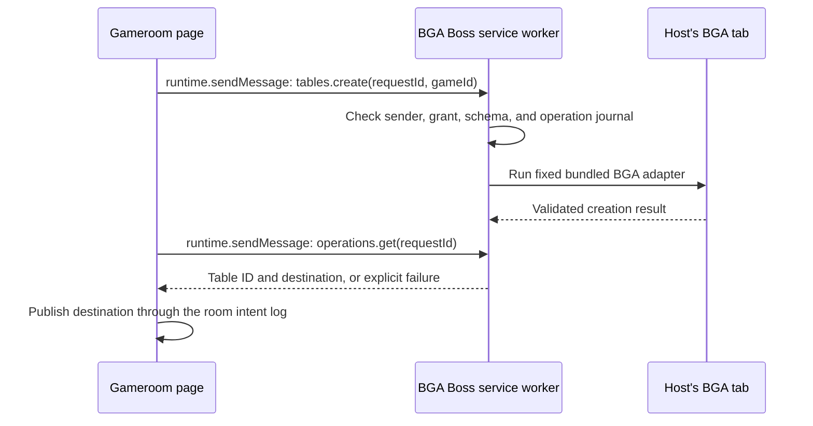

# BGA Boss: design sketch

Status: proposed; this document does not implement or enable BGA integration.

BGA Boss is a small Chrome extension that lets an explicitly approved Gameroom
site request specific BGA actions using the current browser profile's BGA login.
Its first job is to create a table and return its destination automatically.
The host never copies a link. Friends do not need the extension to follow it.

## The experience

1. Once, the host installs BGA Boss, grants access to BGA, and approves their
   Gameroom site in the extension's own settings.
2. The host selects a BGA game and friends in Gameroom, then clicks **Create BGA
   table**. Gameroom records the intended launch and requests table creation.
3. BGA Boss opens a BGA tab using the host's existing BGA login. If login or an
   extension approval is needed, it asks the host to complete that step.
4. Once creation succeeds, BGA Boss returns the table ID and destination to
   Gameroom. Gameroom records the decision to share that destination with the
   selected participants.
5. Friends get **Join BGA table**, opening the same destination in their own BGA
   sessions. Gameroom and its conversation stay open.
6. The host configures and starts the match on BGA. Starting a match through the
   extension can be added as a separately granted capability later.

Opening a table, joining a seat, opening a table to strangers, and starting the
match are distinct actions. A successful navigation does not mean a player has
joined. BGA remains responsible for membership, invitations, Premium checks,
game rules, and outcomes.

## One transport, three components



Use Manifest V3 and `externally_connectable`. Gameroom calls
`chrome.runtime.sendMessage(extensionId, request)` and receives responses. Chrome
delivers the caller's sender metadata to `onMessageExternal`; the extension checks
that metadata itself. This is a documented website-to-extension mechanism.
[Chrome messaging](https://developer.chrome.com/docs/extensions/develop/concepts/messaging),
[external connection configuration](https://developer.chrome.com/docs/extensions/reference/manifest/externally-connectable).

Use short request/response calls and poll an operation while it is pending. No
WebSocket listener, localhost service, backend holding BGA sessions, or persistent
connection is necessary. The extension does not independently push messages into
arbitrary websites, and it does not inject a general API into Gameroom.

On BGA, use `chrome.scripting.executeScript` for a small, fixed adapter function.
Prefer the isolated world where it suffices. If an operation needs BGA's page
configuration, use a narrowly scoped MAIN-world function that performs that
specific operation and returns a small result through Chrome's injection result.
There is no general `window.postMessage` command bus on BGA. MAIN-world code and
its inputs/results are visible to, and influenceable by, the page; they are not
a privileged or secret execution environment.
[Chrome scripting](https://developer.chrome.com/docs/extensions/reference/api/scripting).

This is **an API of BGA actions**, not an API for executing JavaScript or HTTP
requests supplied by a website.

## The initial API

All messages are bounded JSON with a protocol version, a known method, and a
strict method-specific schema. Reject unknown fields as well as unknown methods.

| Method | Purpose | Initial availability |
| --- | --- | --- |
| `capabilities.get` | Report protocol, effective grants, and adapter availability | Yes |
| `tables.create` | Create one table for an explicit BGA game ID | With permission |
| `operations.get` | Recover the status/result of the caller's request | Yes |
| `tables.open` | Open or focus a previously returned BGA table | With permission |
| `tables.invite` | Invite explicit BGA player IDs to a managed table | Later; disabled |
| `tables.start` | Start an explicitly identified managed table | Later; disabled |

For example:

```json
{
  "version": 1,
  "method": "tables.create",
  "requestId": "d2635d16-47f0-4b7e-b947-6a911755ab8e",
  "issuedAt": "2026-11-07T12:00:00Z",
  "gameId": "BGA_GAME_ID",
  "mode": "realtime"
}
```

The game ID is a validated BGA identifier, not a title or URL to interpret. The
extension owns endpoint construction and supported defaults. Arbitrary BGA
options are outside the first API; add specific validated options when needed.
The example is illustrative, not a claim that a real game has that identifier.

Creation returns an accepted operation handle promptly. `operations.get` returns
one of `queued`, `needs_approval`, `needs_login`, `executing`, `succeeded`,
`failed`, or `unknown`. Success includes only the request ID, BGA table ID, and
an extension-constructed, validated BGA destination. Capabilities report what the
extension supports and permits; they do not promise that BGA will accept a call.

Requests cannot specify code, selectors, endpoint paths, headers, cookies,
request tokens, callback URLs, or browser tab IDs. They cannot ask for arbitrary
DOM, network responses, or page contents. `tables.open` takes a managed table
handle, not a caller-provided URL.

## Permission model

There are two gates: Chrome's host permission and BGA Boss's own action grants.
Both must allow an operation. Grants are edited only in extension-owned UI;
Gameroom can request an action but cannot grant itself permission.

- Restrict website connections to named Gameroom deployments. Verify Chrome's
  sender URL/origin, top-level frame, and document/tab context on every request.
  Reject opaque senders, embedded callers, and extension-to-extension callers.
  Never trust an `origin`, `userGesture`, or `approved` field in the payload.
- Pair each permitted client explicitly. Keep operation ownership tied to that
  client, with unguessable request handles; a different client cannot retrieve
  results or operate on its tables without that binding. This is an API guard,
  not isolation between cohosted paths; compromised same-origin code can
  impersonate another client. Room IDs are context, not authentication.
- Require extension confirmation for mutations by default. To get the intended
  one-click experience, the user can grant **Create tables for this Gameroom
  site for this browser session** once. Inviting and starting remain separate,
  disabled-by-default grants. Revocation blocks new dispatches immediately.
- Bind the grant to the BGA account observed during approval. Stop for renewed
  approval if the account changes. Never substitute another account or a bot.
- Operate only on tables created or explicitly adopted through extension UI.
  Serialize mutations, limit outstanding creation requests, and rate-limit calls.
- Request `scripting`, `storage`, and narrowly scoped optional BGA host access.
  Start with canonical `https://boardgamearena.com/*`; add individual hosts only
  when demonstrated necessary. Do not request `<all_urls>`, cookies, debugger,
  native messaging, or blanket browsing-history access. Routine tab creation
  does not justify the broad `tabs` permission. A click inside Gameroom does not
  itself grant Chrome's extension `activeTab` permission.
- Bundle all executable code. No remote code loading, `eval`, or configurable
  scripts. Restrict extension storage to trusted extension contexts; BGA page
  code must not read the journal or change grants.

Production and PR previews deliberately share
`https://gameroom.boardgamescafe.org`, with preview N at `/prN/`, so BGA Boss can
be tested against preview builds. They are one browser origin and one trust
boundary, sharing origin-scoped storage and anonymous Firebase identity. Other
GitHub Pages applications remain on a different origin.

BGA Boss should let the user explicitly enable production and individual
preview paths for testing. Those checks prevent accidental calls from the wrong
client; they cannot isolate compromised preview code from production on the same
origin. Do not claim otherwise or treat the room/path label as authentication.
Only trusted first-party previews should be published here. Development origins
and localhost ports require separate explicit enablement.

No BGA password, session cookie, request token, or raw authenticated response
leaves the browser adapter or enters Gameroom/Firestore. The adapter uses BGA's
existing signed-in session. Gameroom receives the table destination, not account
credentials. BGA player IDs, Gameroom Firebase UIDs, and display names remain
separate; inviting a named friend requires an explicit BGA identity mapping.

## The BGA adapter is the uncertain part

There is a concrete precedent: the existing BGA extension creates tables through
`/table/table/createnew.html`, obtains the returned table ID, and performs
authenticated page-context requests with BGA's request token.
[Creation implementation](https://github.com/FlavienBusseuil/bga-chrome-extension/blob/main/src/js/ui/content/gameList/functions.tsx),
[page adapter implementation](https://github.com/FlavienBusseuil/bga-chrome-extension/blob/main/src/js/bgaApi.ts).

That is evidence of technical feasibility, not a documented stable third-party
API or a blanket authorization from BGA. Keep this dependency inside one adapter,
verify BGA's applicable integration rules, and test against the current signed-in
site before promising support. The prior research used public source and
unauthenticated reads; it did not create a live BGA table.

In particular, verify table privacy and the actual join destination. Do not
assume `forceManual=true` makes a table private, or that a bare table URL carries
all invitation permissions. Do not automatically call an “open table” endpoint
that advertises the table to strangers. Initially, require a proven unadvertised
creation flow and let the host start the match in BGA. If privacy or invitation
semantics cannot be established, return unsupported rather than silently using
public matchmaking.

## Retries must not create extra tables

The extension is an executor, not Gameroom's event store. It does need a small
local operation journal: client binding, request ID, validated payload hash,
stage, BGA account/tab association, and sanitized result. Store it in
`chrome.storage.local`, not just worker globals, with bounded retention and a
clear-history control. Keep session action grants in session storage so browser
restart does not silently re-enable automation. Chrome may terminate an idle
extension worker, so process lifetime cannot be the source of truth.
[Worker lifecycle](https://developer.chrome.com/docs/extensions/develop/concepts/service-workers/lifecycle),
[extension storage](https://developer.chrome.com/docs/extensions/reference/api/storage).

Persist the operation before dispatch. The same request ID and payload return
the existing operation/result; reuse with a different payload is rejected.
Persist `executing` before issuing a mutation, and allow only one dispatcher for
that operation. Reloading Gameroom polls the existing request; it never creates
a fresh request ID merely because a response was lost.

New mutations also need a short freshness window on their original `issuedAt`;
retries preserve that value. Retain receipts beyond that window. An old request
whose receipt has expired is rejected as expired, not treated as a new creation.
Clearing operation history revokes the associated client grants and invalidates
their outstanding requests. Retention must never turn a delayed retry into an
automatic fresh table.

**There is no honest exactly-once guarantee across BGA and local storage.** If
BGA creates a table and the worker dies before recording its ID, creation may
have happened. Return `unknown`, inspect/reconcile the associated BGA tab, and
allow explicit adoption of the existing table. Do not blindly repeat creation.
If reconciliation is ambiguous, ask the host to resolve it in extension UI.
Revoking permission cannot undo an already-dispatched BGA action.

## Fit with Gameroom

Keep room persistence in Firestore and preserve the canonical versioned intent
log. The extension has no Firebase credentials and never writes room events.
Gameroom records the host's launch request and decision to publish the returned
destination, using stable command IDs, expected revisions, and attribution.
Publishing a BGA destination records intended participation; it is not proof of
joined seats, a running game, or any external outcome. Adapter observations and
operation progress stay outside the canonical room log.

The current room protocol is version 2. Introduce a new version for BGA launch
decisions; do not reinterpret existing URL-contract launches or old histories.
If publishing to Firestore fails after creation, retry publishing the known
destination with the original command ID, not BGA creation. Remote room members
cannot cause the host's extension to create tables by posting room events: only
an approved local client request can dispatch that action.

The catalog also needs an **explicit provider discriminator and BGA game ID**
before this is enabled. Today `GameroomEnabled: integrated` uses the existing
create/join URL contract; it does not identify BGA. Extend the typed catalog,
editor, and shared rules deliberately. Do not infer BGA integration from a title,
document ID, or WebURL hostname. No production catalog migration is part of
this sketch.

Only the creating host needs BGA Boss for the first release. Each friend follows
the shared BGA destination through ordinary tab opening and BGA's join flow.
Preserve popup fallback, opener isolation, per-launch attempt receipts, explicit
reopen controls, and uninterrupted room chat. The extension must return results
without relying on an opener relationship to BGA.

## First proof and acceptance criteria

Build one adapter for one BGA game and only the four initial methods. Use Bun
for the extension tooling. Validate the bridge locally before adding invites,
automatic match start, or more configuration.

- In real Chrome with the installed extension, the approved host creates one
  table from Gameroom without copying a link; a second independently signed-in
  BGA profile reaches that same table without installing the extension.
- Show login, missing Premium, denied permission, revoked permission, changed
  BGA account, and unsupported BGA behavior as explicit states.
- Reject unapproved origins or client paths, subframes, malformed or
  oversized messages, arbitrary URLs/code, and commands for unmanaged tables.
  Also document the same-origin limitation above; a path check does not fix it.
- Retry identical requests, reload Gameroom, suspend/restart the worker, and
  inject a lost-result failure after creation. No automatic second creation is
  allowed for an uncertain result; conflicting payloads are rejected.
- Verify that the table remains unadvertised, the invitation actually grants
  the intended access, and nobody is accidentally routed into public matchmaking.
- Keep the room, chat, and explicit reopen controls functional throughout.

Use deterministic fixtures for automated adapter failures and real independent
Auth/Firestore emulator clients for room integration. Exercise a real unpacked
extension in the Chrome bridge tests. Record a small manual acceptance against
actual logged-in BGA accounts separately; do not call mocked BGA responses a live
integration test. Extend Gameroom's TestStepHelper stories and exact RGBA
screenshots for its UI, with the existing viewports and explicit reference
generation. BGA's changing third-party page is not a deterministic pixel baseline.

The first success is deliberately small: **one approved host action creates one
BGA table, and everyone in the gathering can open the right destination.**

## Implemented test bridge (November 2026)

The first PR deliberately implements **user-mediated preparation and automatic
URL capture**, rather than the speculative automatic `tables.create` adapter
above. The shipped methods are `capabilities.get`, `tables.prepare`, and
`operations.get`. Each preparation requires approval in extension UI and opens
one managed BGA game page. The host uses BGA's own login, access controls, table
creation and start controls. The extension observes only that managed tab's
`/table?table=NUMBER` destination and returns a canonical, token-free URL.
Gameroom automatically publishes that selected destination and intended players
as a version 3 `table/bga-launched` decision. A failed room publication can be
retried without repeating preparation or creating another BGA tab.

This avoids scripting, request tokens and account-bound grants entirely for the
PoC. The extension has only `storage` permission and BGA host permissions. There
is no session-wide grant: approval applies to one request. Existing requests are
bound to their original client path and browser tab. The local journal retains
IDs beyond the freshness window, rejects payload changes, serializes updates,
and treats interruptions during tab opening as unknown. The extension toolbar
reopens pending approvals. No automatic adoption of unrelated tabs is attempted.

The one explicit adapter is Can't Stop, game ID 11 as displayed by BGA's public
[game page](https://boardgamearena.com/gamepanel?game=cantstop). It is available
only through the opt-in `?bga=1` test launcher, separate from `Applications`.
Catalog-backed BGA selection still requires the explicit provider metadata and
editor changes described above; no production catalog was changed for this PoC.

Use a fresh room on the preview for testing. Protocol 1 and 2 histories retain
their existing replay semantics, but once a room contains version 3 events,
older production clients cannot replay it. Keep the invitation on the preview's
path rather than opening that room on an older production build.

Automated tests exercise the real unpacked Chrome extension and native external
messaging, with synthetic BGA pages and real independent Firebase emulator
identities. They do not establish live BGA table access, Premium requirements,
privacy or actual seating. These remain manual acceptance items. In particular,
if a private table requires a separate invitation token, the token-free URL may
not grant access. Do not compensate by advertising the table publicly: report
that result and design explicit invitation support next.

The install guide and extension ZIP are included in each preview build at
`bga-boss-install.html` and `bga-boss.zip`. Inspect and approve these first-stage
results before adding automatic creation, invitations or match start.
