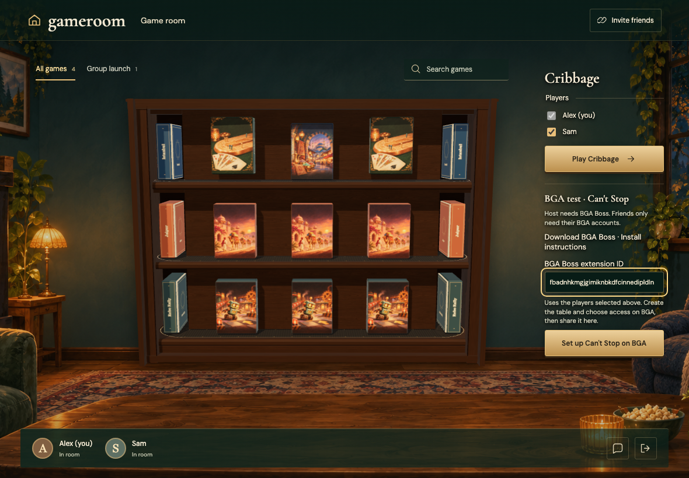
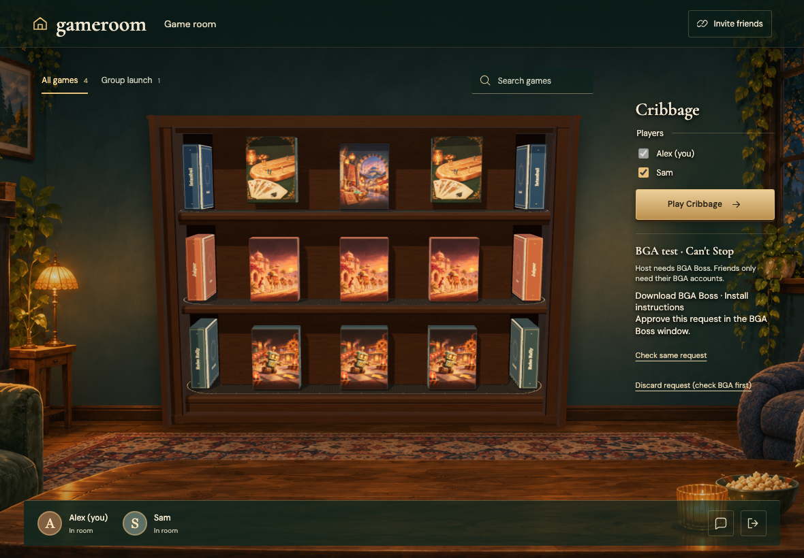
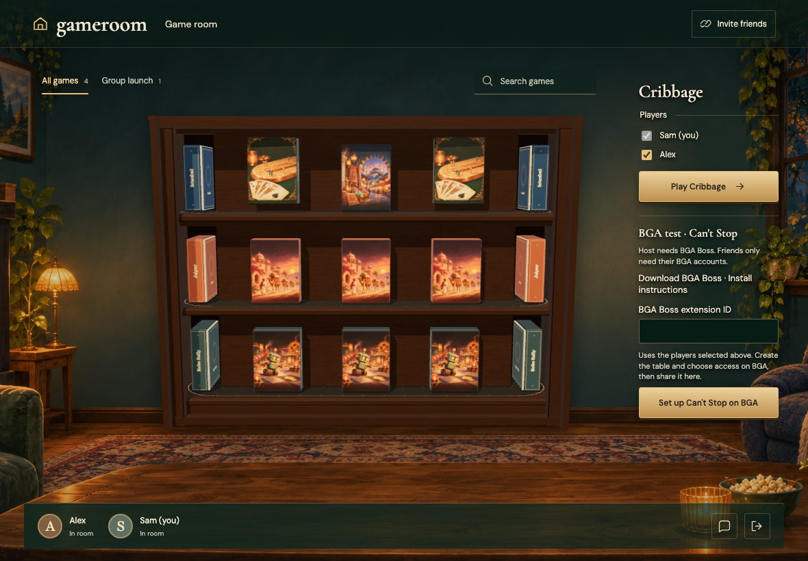
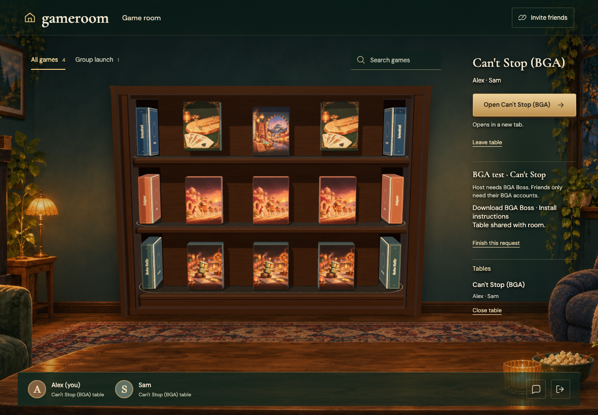
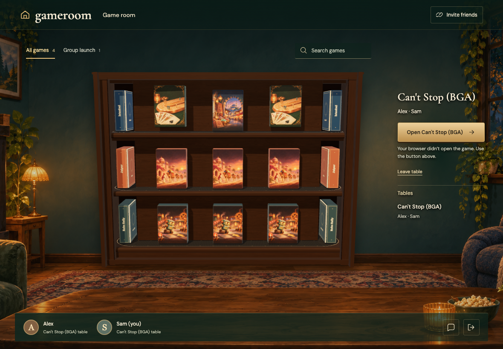
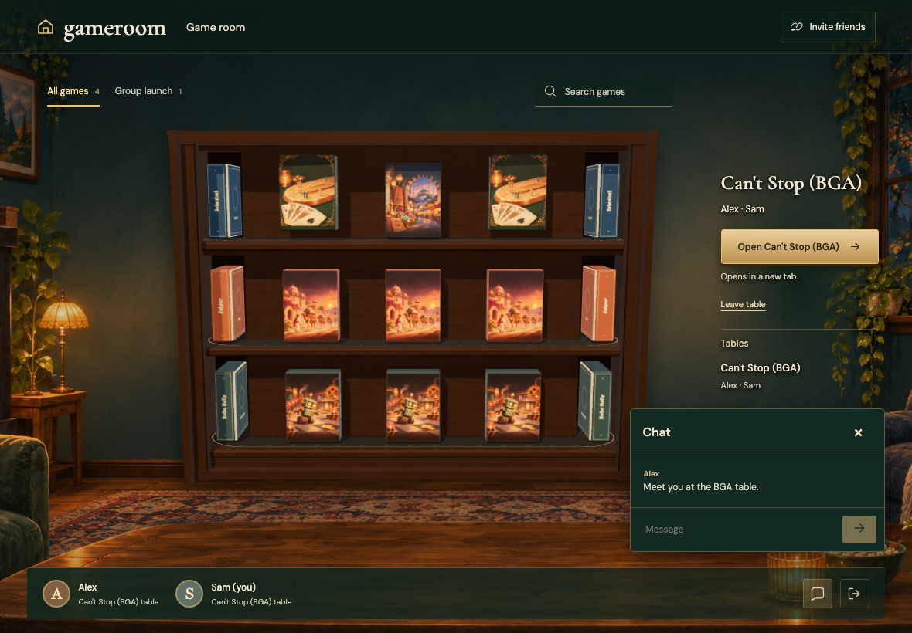
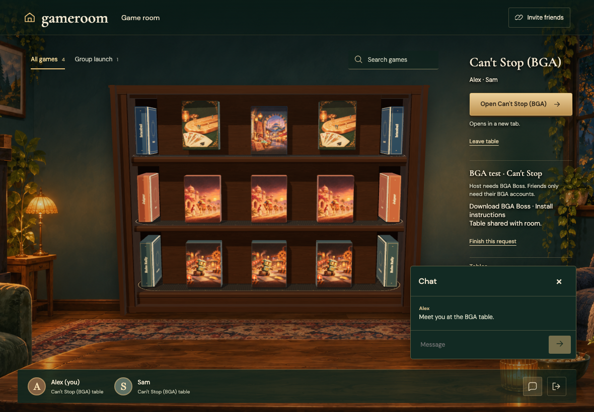
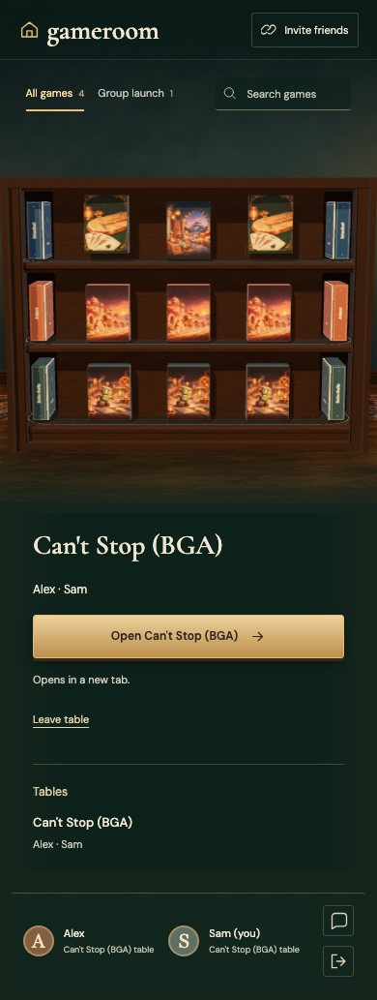

# BGA-LAUNCH

Real Firestore and Auth emulators; independent browser identities. Desktop captures are 1180×820 at 1×; mobile captures are 390×844 with full-page capture. Every decoded RGBA byte must match. No masks, pixel tolerance, screenshot resizing or retries. Baselines are generated explicitly and verified in a separate run.

## The host can set up BGA without changing the shared catalog

Viewpoint: **Alex**

- [x] Both independent profiles remain in the gathering

## The host can set up BGA without changing the shared catalog

Viewpoint: **Sam**

- [x] Both independent profiles remain in the gathering

## BGA Boss requires approval before opening BGA

Viewpoint: **Alex**

- [x] Both independent profiles remain in the gathering

## BGA Boss requires approval before opening BGA

Viewpoint: **Sam**

- [x] Both independent profiles remain in the gathering

## The host creates the table through BGA controls

Viewpoint: **Alex**

- [x] Both independent profiles remain in the gathering

## The host creates the table through BGA controls

Viewpoint: **Sam**

- [x] Both independent profiles remain in the gathering

## Both selected profiles receive the same BGA table and a reopen control

Viewpoint: **Alex**

- [x] Both independent profiles remain in the gathering

## Both selected profiles receive the same BGA table and a reopen control

Viewpoint: **Sam**

- [x] Both independent profiles remain in the gathering

## The friend opens the exact BGA URL and continues using the room

Viewpoint: **Alex**

- [x] Both independent profiles remain in the gathering

## The friend opens the exact BGA URL and continues using the room

Viewpoint: **Sam**

- [x] Both independent profiles remain in the gathering

## Reload creates no duplicate BGA tab and room chat continues

Viewpoint: **Alex**

- [x] Both independent profiles remain in the gathering

## Reload creates no duplicate BGA tab and room chat continues

Viewpoint: **Sam**

- [x] Both independent profiles remain in the gathering

## The mobile friend retains a usable reopen control

Viewpoint: **Alex**

- [x] Both independent profiles remain in the gathering

## The mobile friend retains a usable reopen control

Viewpoint: **Sam**

- [x] Both independent profiles remain in the gathering
