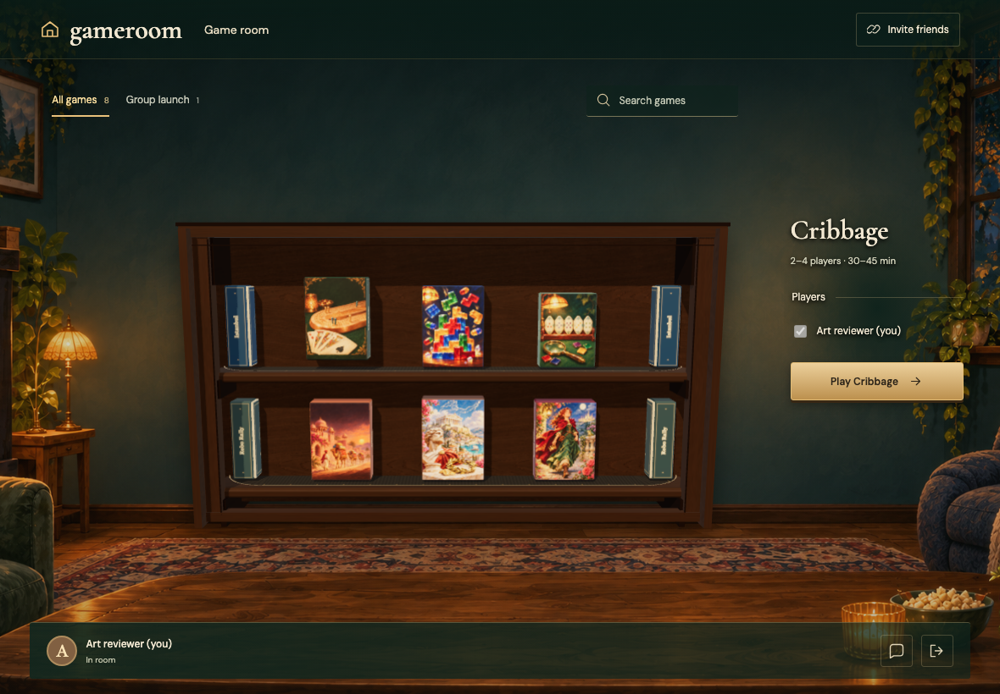
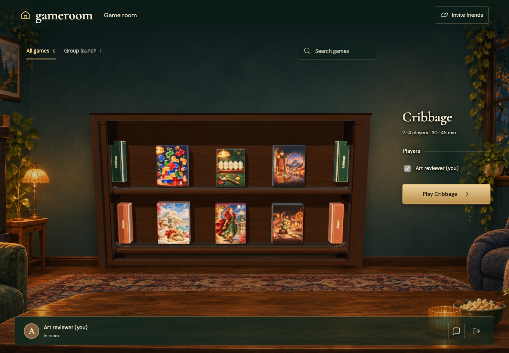
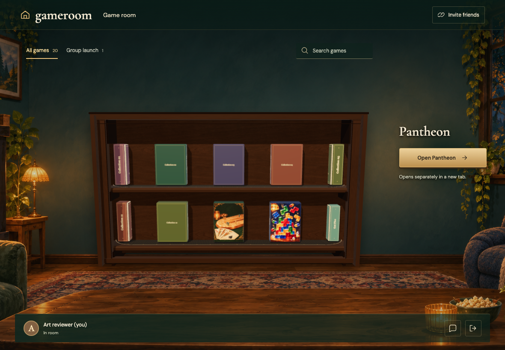
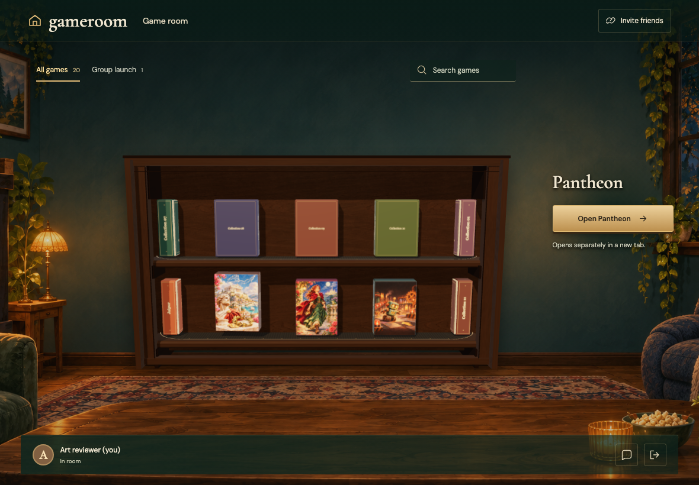
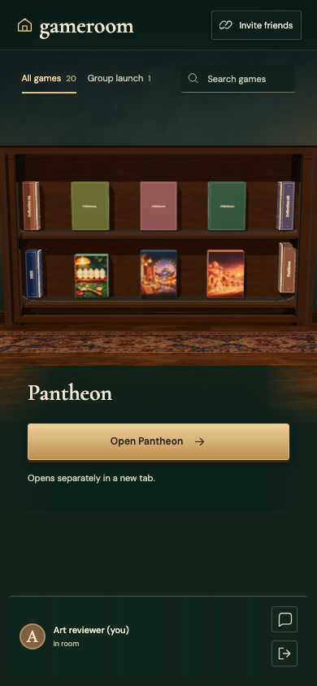
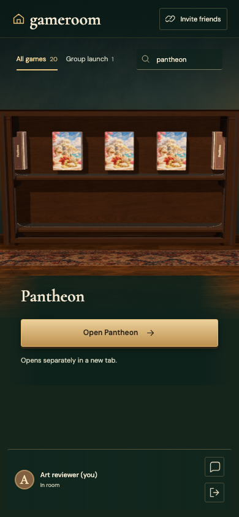
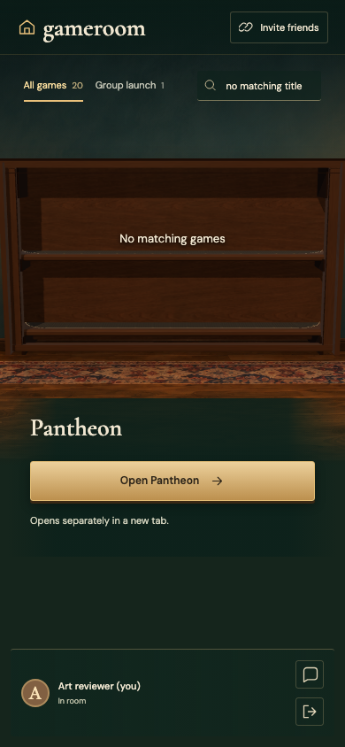

# CABINET

Real Firestore and Auth emulators; independent browser identities. Desktop captures are 1180×820 at 1×; mobile captures are 390×844 with full-page capture. Every decoded RGBA byte must match. No masks, pixel tolerance, screenshot resizing or retries. Baselines are generated explicitly and verified in a separate run.

## The eight-game catalog can browse in the embedded cabinet

Viewpoint: **Reader**

- [x] Six boxes are visible and browsing is enabled for the actual eight-game collection

## Wheel input browses the production-sized eight-game collection

Viewpoint: **Reader**

- [x] Both final games arrive through the slim closed ends

## The shelves continue beyond their original sequence

Viewpoint: **Reader**

- [x] Position nine repeats position one without an end stop or visible controls

## Keyboard browsing also repeats through negative positions

Viewpoint: **Reader**

- [x] Position minus seven reaches the same games from the other direction

## A native click on the 3D Pantheon box selects it

Viewpoint: **Reader**

- [x] The selected box lifts and the independent URL action follows the selection

## Wheel input carries new boxes through the concealed return loop

Viewpoint: **Reader**

- [x] The twenty-game collection moves without adding visible scroll controls

## A larger catalog repeats as many times as needed

Viewpoint: **Reader**

- [x] Position twenty-seven still exposes the final games without a boundary

## A horizontal swipe moves the belts without selecting a box

Viewpoint: **Reader**

- [x] Touch reaches position four while the previous selection stays intact

## Search narrows a large catalog to one illustrated box

Viewpoint: **Reader**

- [x] One semantic game choice repeats around its shelf and can keep scrolling

## An empty search keeps the cabinet and room available

Viewpoint: **Reader**

- [x] Empty shelves show a useful result message
