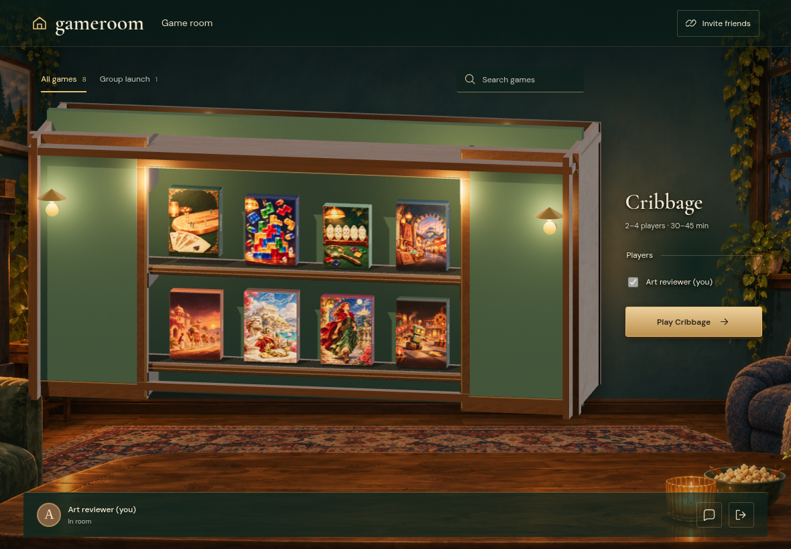
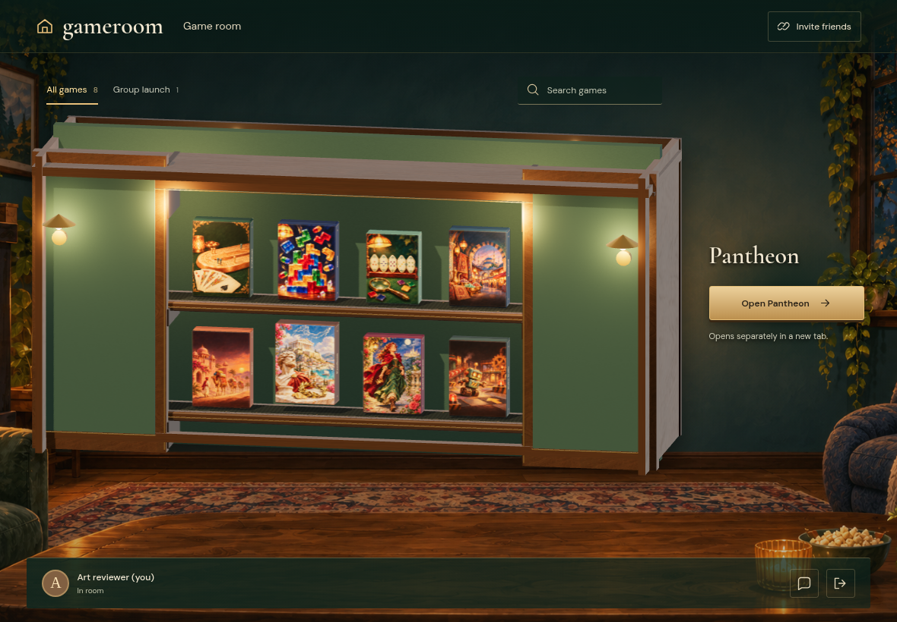
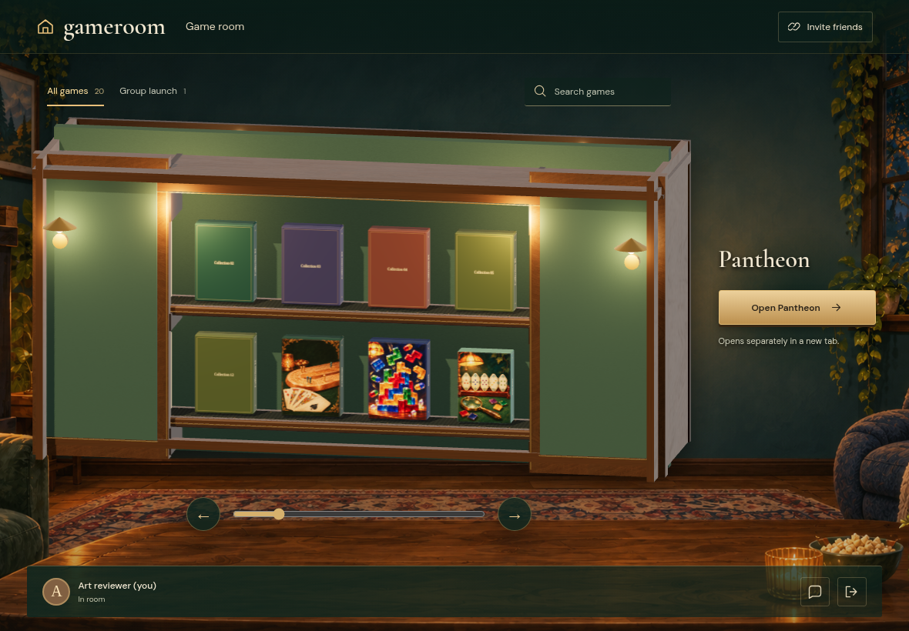
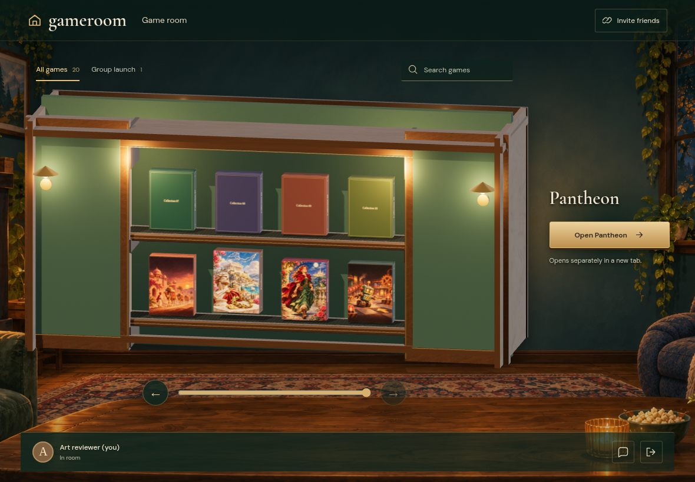
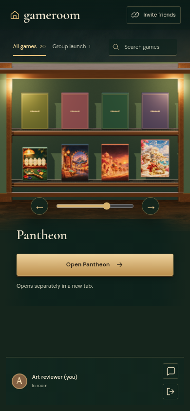
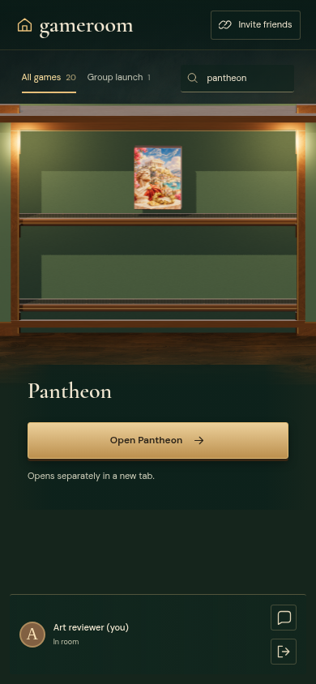
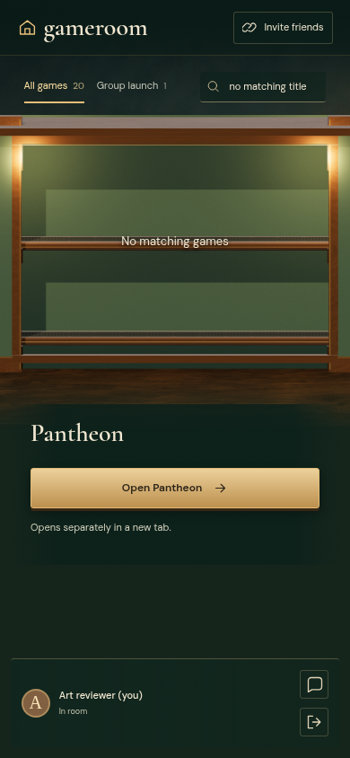

# CABINET

Real Firestore and Auth emulators; independent browser identities. Desktop captures are 1180×820 at 1×; mobile captures are 390×844 with full-page capture. Every decoded RGBA byte must match. No masks, pixel tolerance, screenshot resizing or retries. Baselines are generated explicitly and verified in a separate run.

## Eight illustrated boxes fit on the two enclosed shelves

Viewpoint: **Reader**

- [x] All eight games are available without duplicate title overlays or pagination

## A native click on the 3D Pantheon box selects it

Viewpoint: **Reader**

- [x] The selected box lifts and the independent URL action follows the selection

## Wheel input carries new boxes through the concealed return loop

Viewpoint: **Reader**

- [x] The finite twenty-game collection moves one position and remains bounded

## The keyboard slider reaches the end of the catalog

Viewpoint: **Reader**

- [x] The final covers are accessible and the next control is disabled

## A horizontal swipe moves the belts without selecting a box

Viewpoint: **Reader**

- [x] Touch reaches position four while the previous selection stays intact

## Search narrows a large catalog to one illustrated box

Viewpoint: **Reader**

- [x] One matching box remains and unnecessary browsing controls disappear

## An empty search keeps the cabinet and room available

Viewpoint: **Reader**

- [x] Empty shelves show a useful result message
