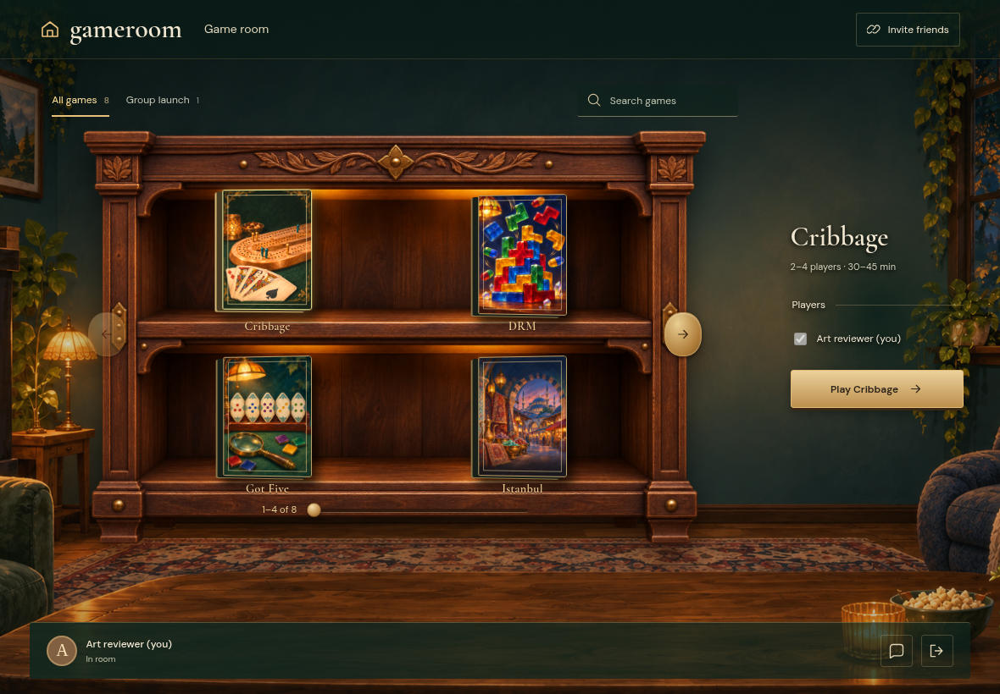
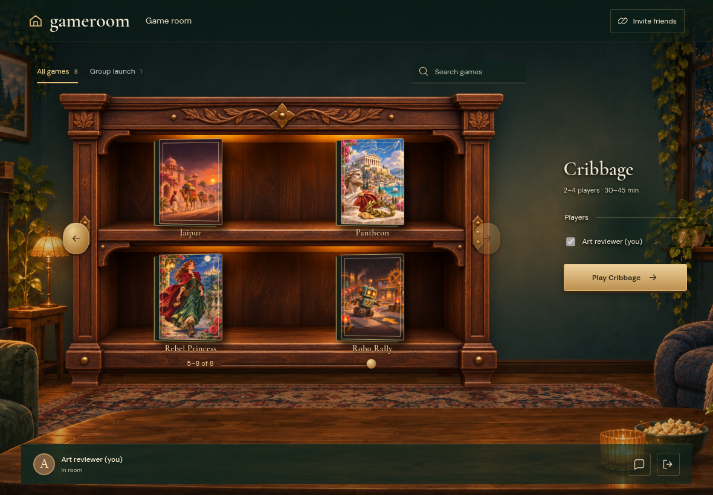
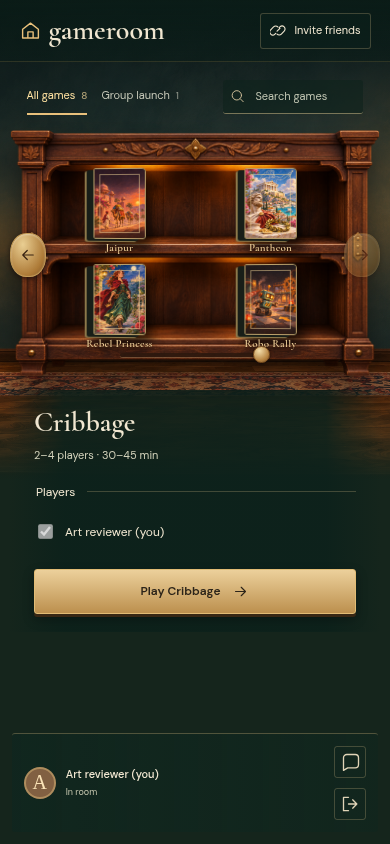
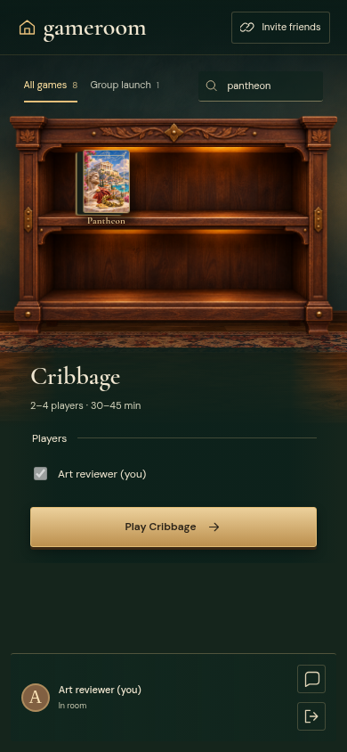

# CABINET

Real Firestore and Auth emulators; independent browser identities. Desktop captures are 1180×820 at 1×; mobile captures are 390×844 with full-page capture. Every decoded RGBA byte must match. No masks, pixel tolerance, screenshot resizing or retries. Baselines are generated explicitly and verified in a separate run.

## Painted covers and printed shelf labels fill the cabinet

Viewpoint: **Reader**

- [x] The first four of eight games have art and a disabled previous arrow

## Brass arrows advance the collection without moving the room

Viewpoint: **Reader**

- [x] The other four covers are visible and the end boundary disables Next

## A horizontal swipe browses while vertical room scrolling stays available

Viewpoint: **Reader**

- [x] Swiping shows the final four covers without accidentally selecting one

## Search narrows a large catalogue to one illustrated box

Viewpoint: **Reader**

- [x] The matching box remains full size and unnecessary browsing controls disappear
