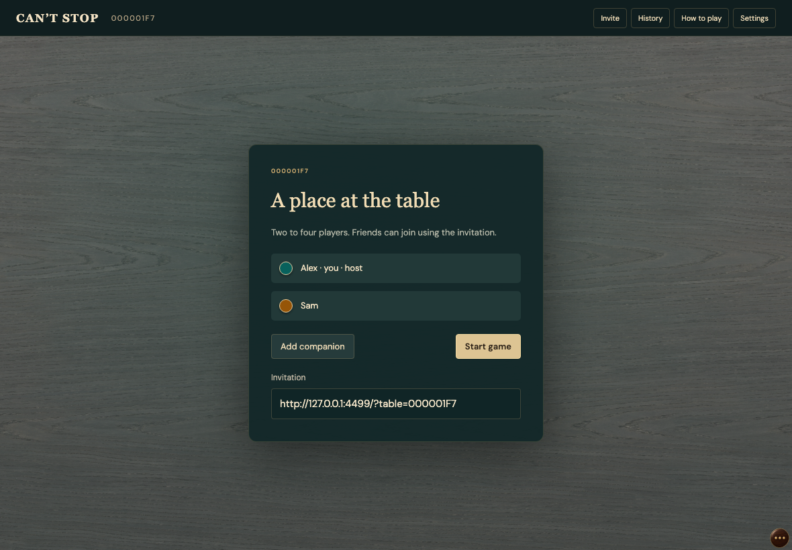
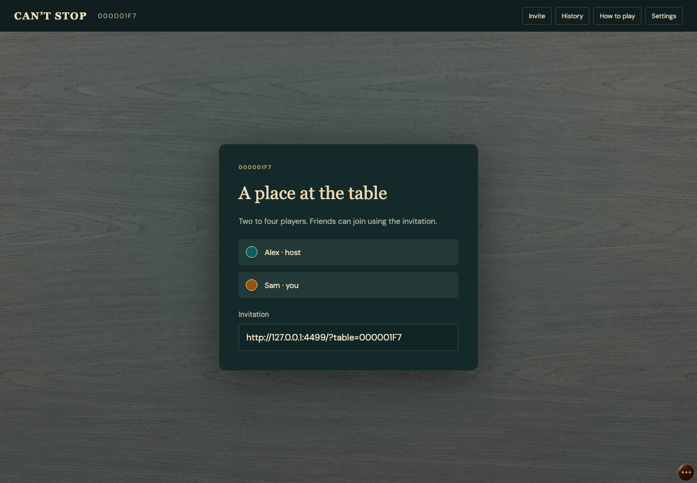
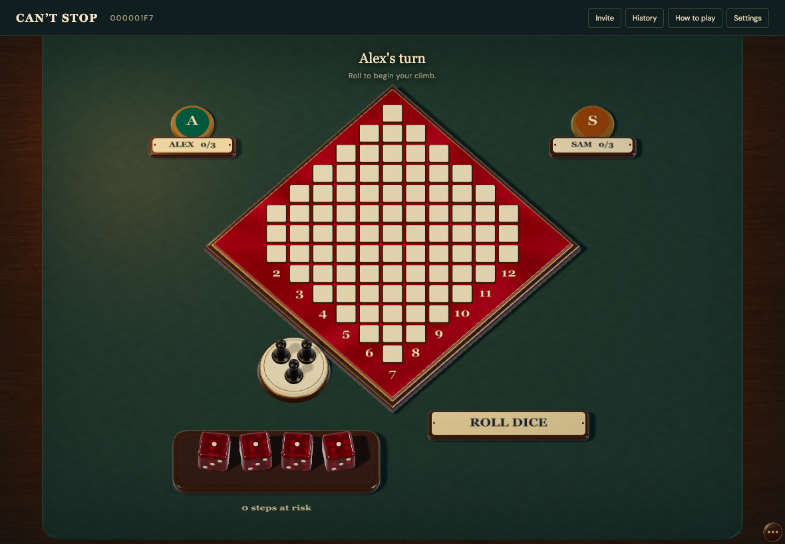
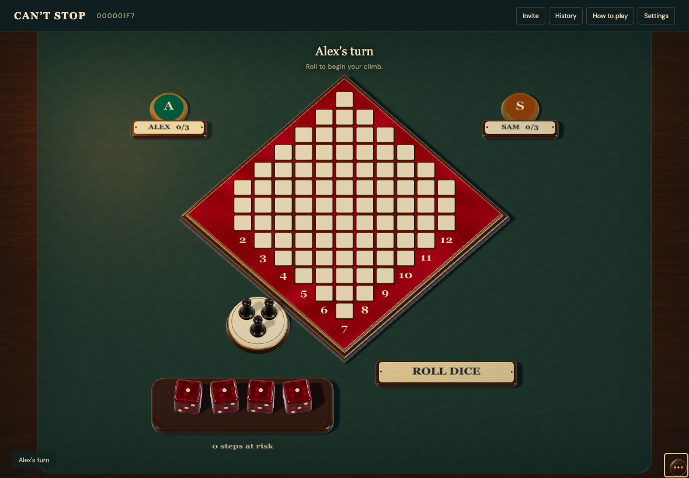
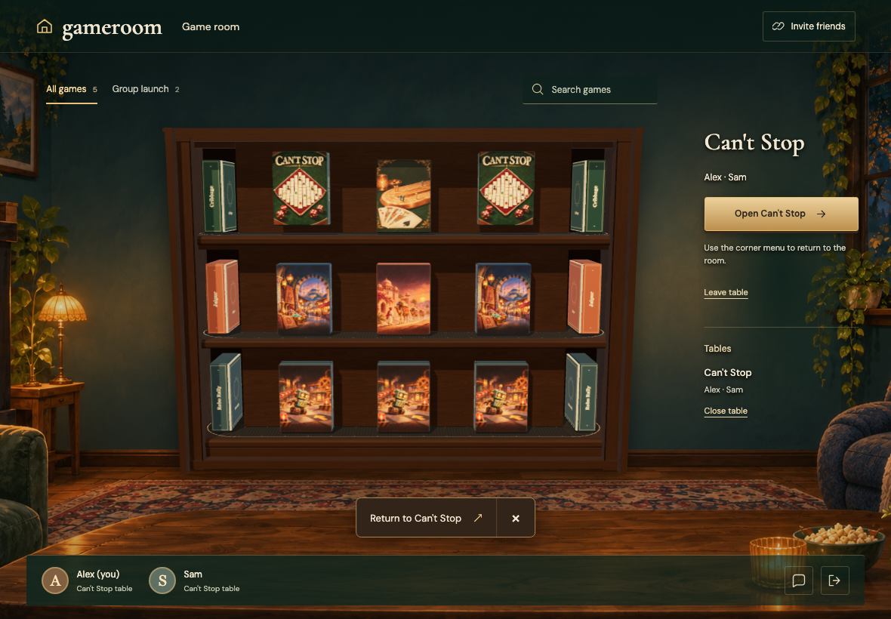
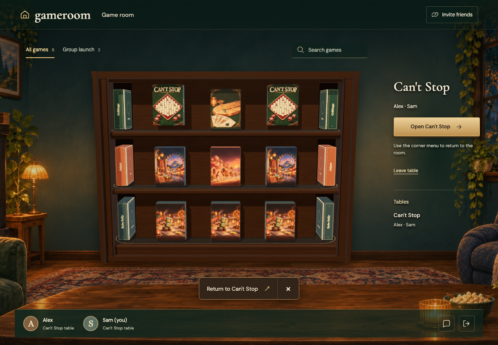

# CANTSTOP-LAUNCH

Real Firestore and Auth emulators; independent browser identities. Desktop captures are 1180×820 at 1×; mobile captures are 390×844 with full-page capture. Every decoded RGBA byte must match. No masks, pixel tolerance, screenshot resizing or retries. Baselines are generated explicitly and verified in a separate run.

## Both profiles automatically enter the same Can’t Stop table

Viewpoint: **Alex**

- [x] There are two independently authenticated seats and no extra tabs

## Both profiles automatically enter the same Can’t Stop table

Viewpoint: **Sam**

- [x] There are two independently authenticated seats and no extra tabs

## Both game frames show the same playable Can’t Stop table

Viewpoint: **Alex**

- [x] Reload retains the same seats and replay revision

## Both game frames show the same playable Can’t Stop table

Viewpoint: **Sam**

- [x] Reload retains the same seats and replay revision

## The gathering stays mounted underneath the game

Viewpoint: **Alex**

- [x] The original invitation, room members and recent game remain available

## The gathering stays mounted underneath the game

Viewpoint: **Sam**

- [x] The original invitation, room members and recent game remain available
