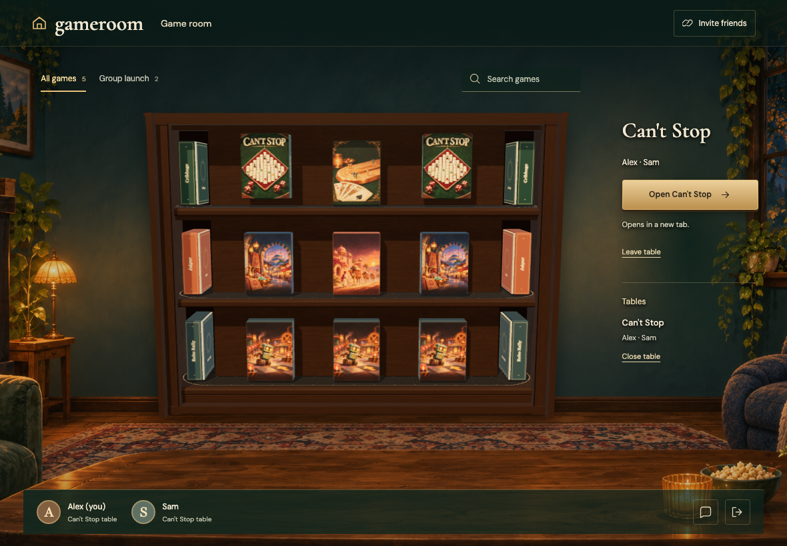
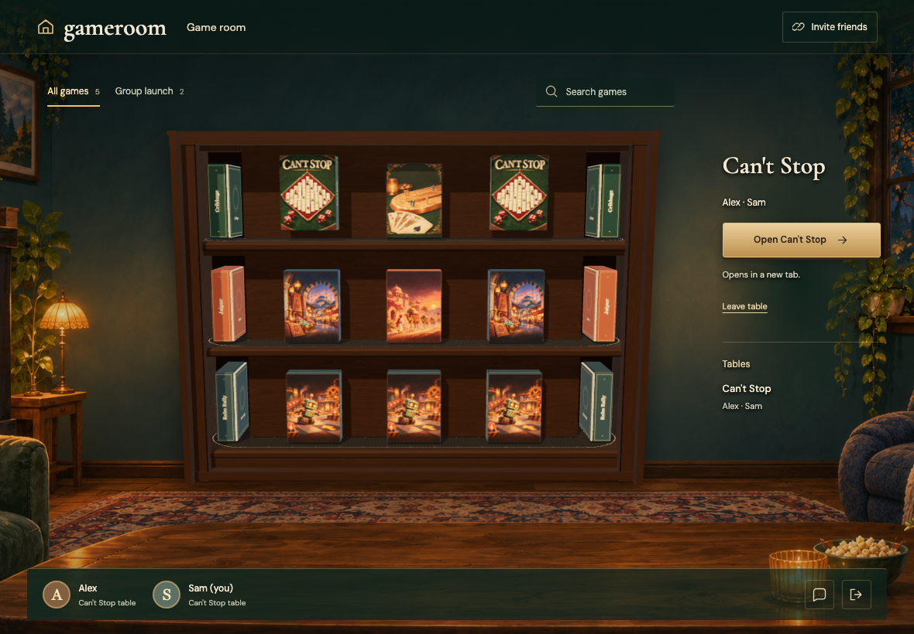
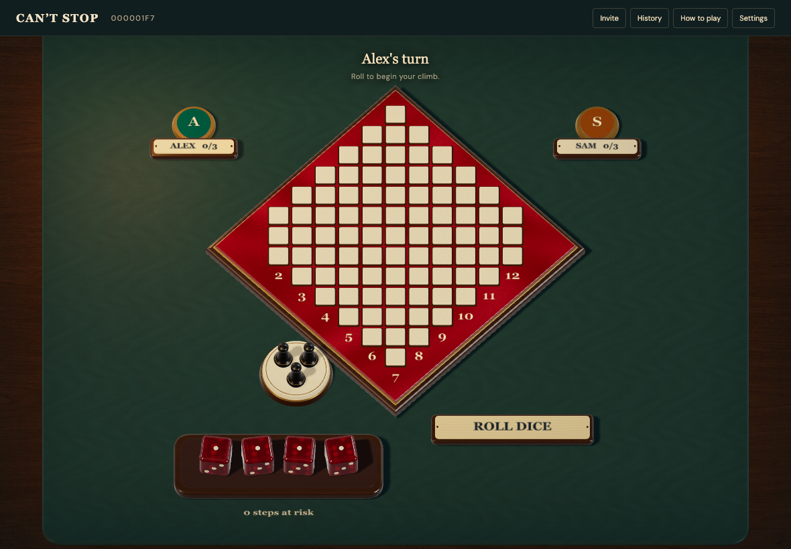
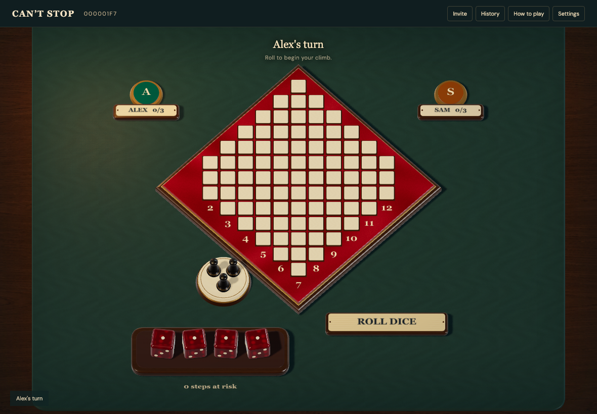

# CANTSTOP-LAUNCH

Real Firestore and Auth emulators; independent browser identities. Desktop captures are 1180×820 at 1×; mobile captures are 390×844 with full-page capture. Every decoded RGBA byte must match. No masks, pixel tolerance, screenshot resizing or retries. Baselines are generated explicitly and verified in a separate run.

## The room stays open with a Can’t Stop reopen control

Viewpoint: **Alex**

- [x] The gathering keeps both players and reopens the chosen game

## The room stays open with a Can’t Stop reopen control

Viewpoint: **Sam**

- [x] The gathering keeps both players and reopens the chosen game

## Both independent identities see the same playable Can’t Stop table

Viewpoint: **Alex**

- [x] Reopening retains two seats and the same replay revision

## Both independent identities see the same playable Can’t Stop table

Viewpoint: **Sam**

- [x] Reopening retains two seats and the same replay revision
