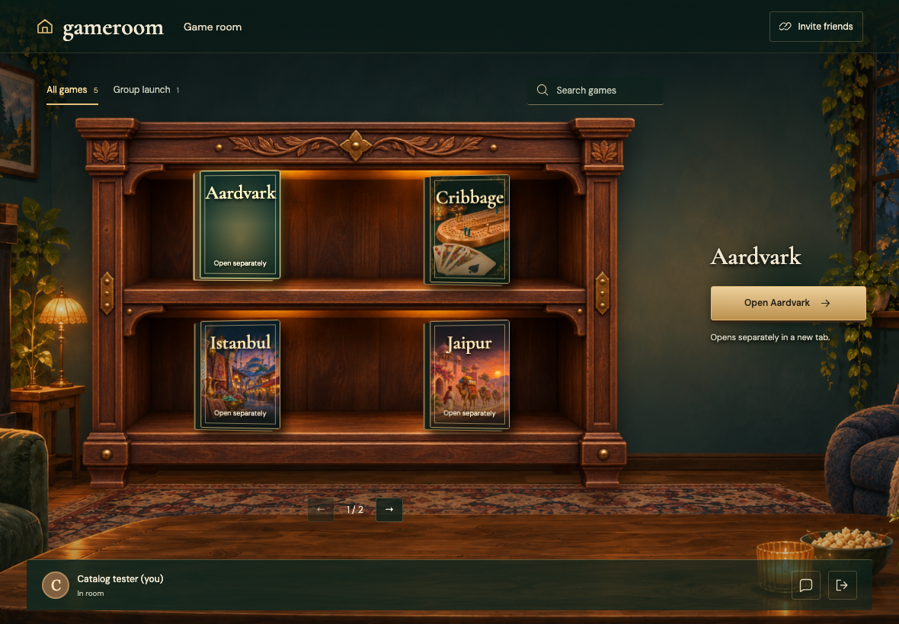
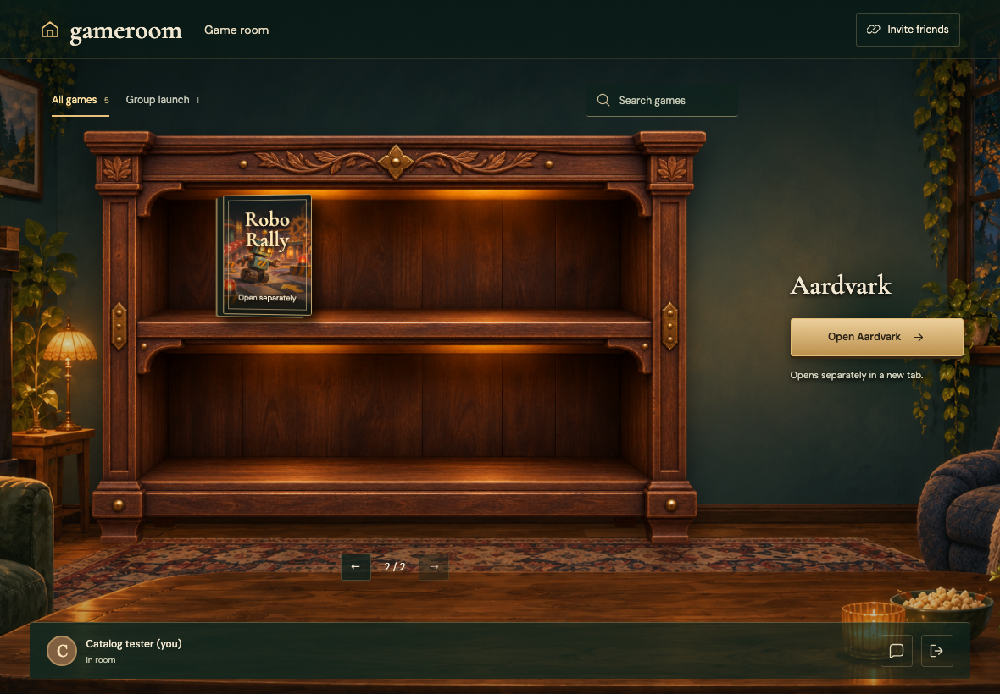
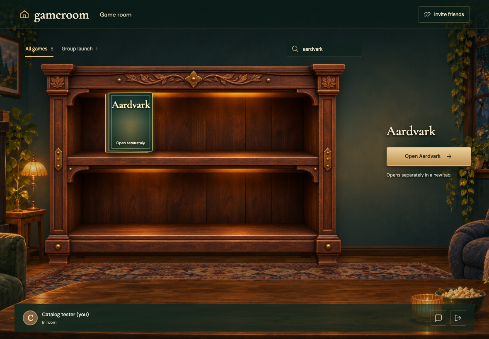
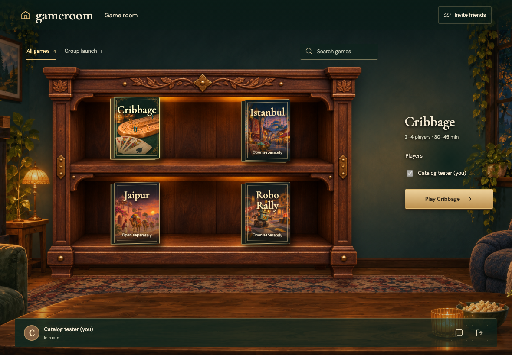

# CATALOGUE

Real Firestore and Auth emulators; independent browser identities. Desktop captures are 1180×820 at 1×; mobile captures are 390×844 with full-page capture. Every decoded RGBA byte must match. No masks, pixel tolerance, screenshot resizing or retries. Baselines are generated explicitly and verified in a separate run.

## A catalog document arrives through the Firestore subscription

Viewpoint: **Reader**

- [x] Five games produce two shelves without scrolling the desktop room

## The same cabinet browses a larger collection

Viewpoint: **Reader**

- [x] The second shelf contains Robo Rally

## A URL-only entry opens separately without invented group support

Viewpoint: **Reader**

- [x] The original room stays open and no group table was recorded

## Hidden and invalid entries disappear without rewriting catalog data

Viewpoint: **Reader**

- [x] Only the four valid visible entries remain
