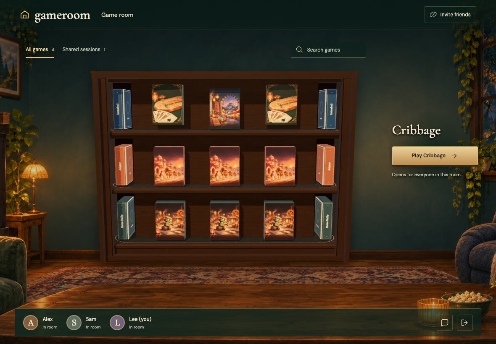
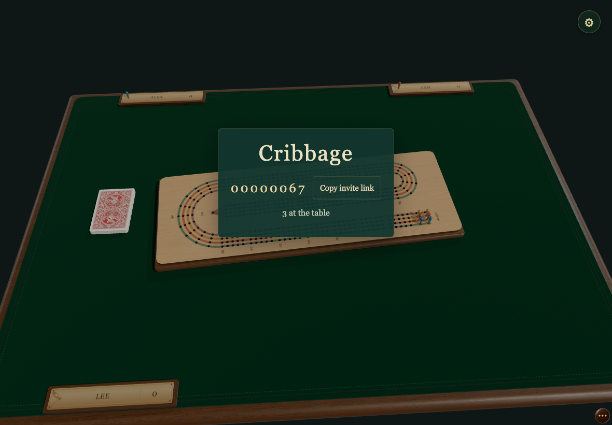
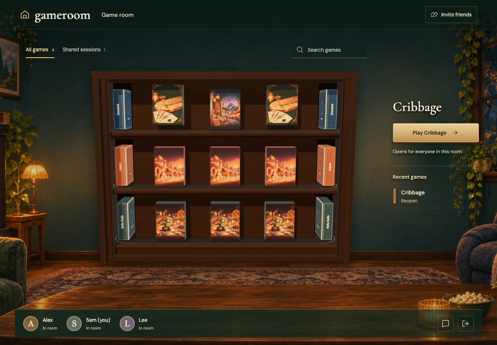

# CONCURRENT-ARRIVALS

Real Firestore and Auth emulators; independent browser identities. Desktop captures are 1180×820 at 1×; mobile captures are 390×844 with full-page capture. Every decoded RGBA byte must match. No masks, pixel tolerance, screenshot resizing or retries. Baselines are generated explicitly and verified in a separate run.

## Every room member is included in the shared game

Viewpoint: **Alex**

- [x] Three profiles share one room without player selection controls

## Every room member is included in the shared game

Viewpoint: **Sam**

- [x] Three profiles share one room without player selection controls

## Every room member is included in the shared game

Viewpoint: **Lee**

- [x] Three profiles share one room without player selection controls

## One host click opens three overlays with distinct game seats

Viewpoint: **Alex**

- [x] Every room member shares the table without opening any tabs

## One host click opens three overlays with distinct game seats

Viewpoint: **Sam**

- [x] Every room member shares the table without opening any tabs

## One host click opens three overlays with distinct game seats

Viewpoint: **Lee**

- [x] Every room member shares the table without opening any tabs

## One member closes the shared game for the whole room

Viewpoint: **Alex**

- [x] Every profile returns to the same recent game link with no extra tabs

## One member closes the shared game for the whole room

Viewpoint: **Sam**

- [x] Every profile returns to the same recent game link with no extra tabs

## One member closes the shared game for the whole room

Viewpoint: **Lee**

- [x] Every profile returns to the same recent game link with no extra tabs
