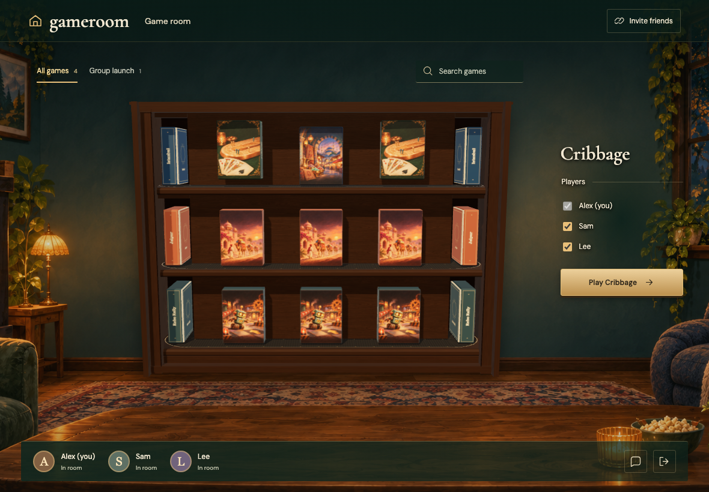
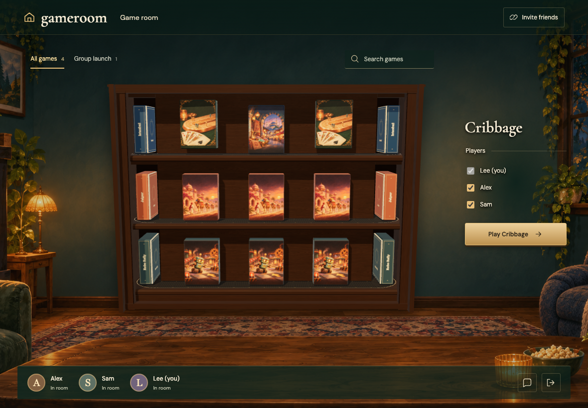
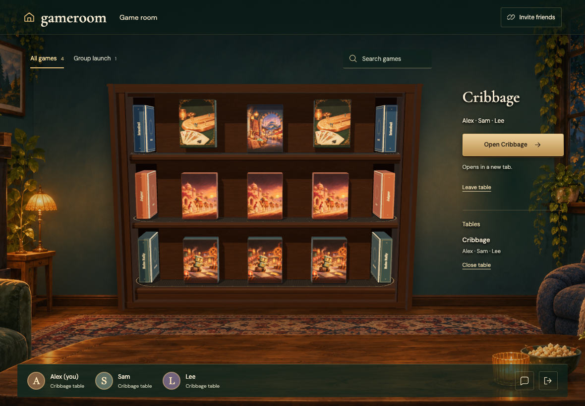
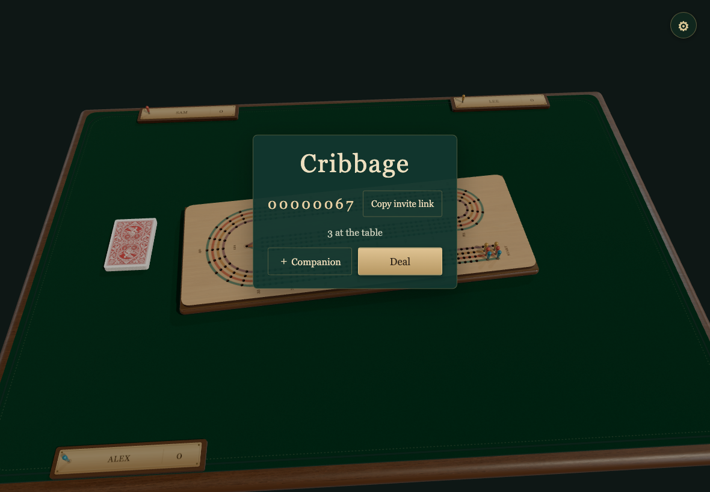
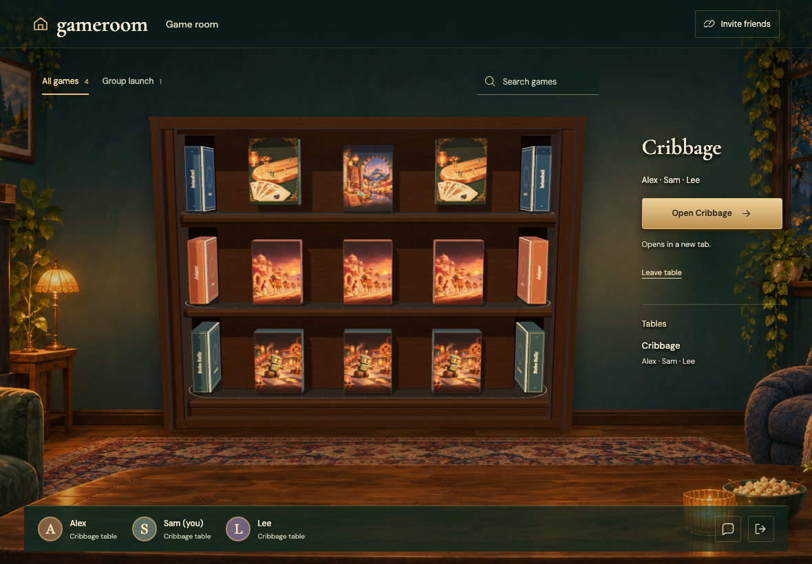
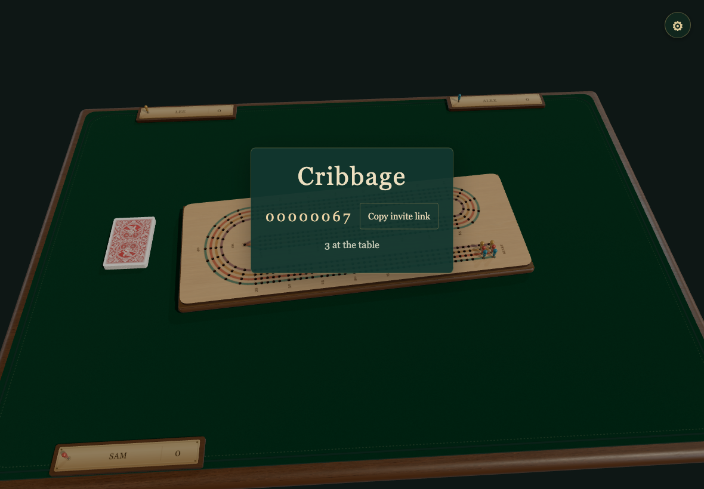
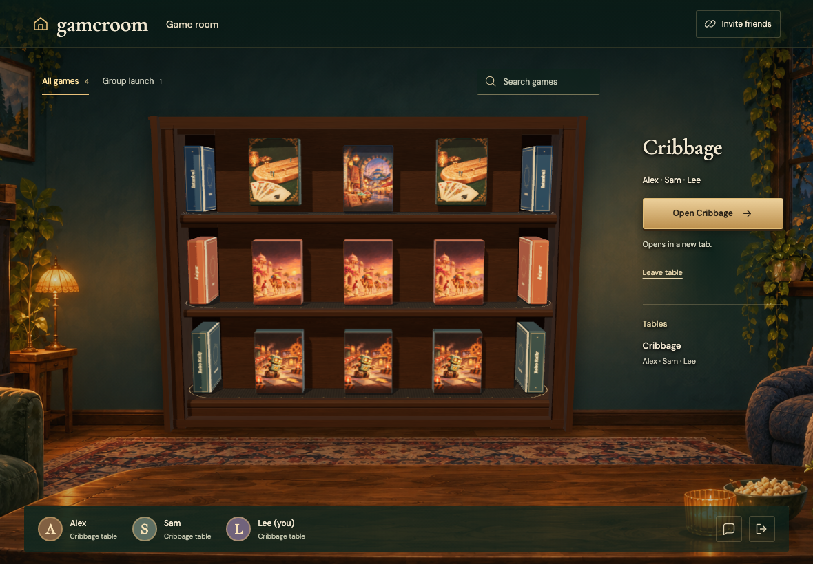

# CONCURRENT-ARRIVALS

Real Firestore and Auth emulators; independent browser identities. Desktop captures are 1180×820 at 1×; mobile captures are 390×844 with full-page capture. Every decoded RGBA byte must match. No masks, pixel tolerance, screenshot resizing or retries. Baselines are generated explicitly and verified in a separate run.

## Three friends are included in the game by default

Viewpoint: **Alex**

- [x] All three friends share one room

## Three friends are included in the game by default

Viewpoint: **Sam**

- [x] All three friends share one room

## Three friends are included in the game by default

Viewpoint: **Lee**

- [x] All three friends share one room

## Every gathering tab stays open with a reopen control

Viewpoint: **Alex**

- [x] No guest click was needed and only one game tab opened per profile

## One host click opens all three game tabs when popups are permitted

Viewpoint: **Alex**

- [x] Each URL names the right player and shares the table

## Every gathering tab stays open with a reopen control

Viewpoint: **Sam**

- [x] No guest click was needed and only one game tab opened per profile

## One host click opens all three game tabs when popups are permitted

Viewpoint: **Sam**

- [x] Each URL names the right player and shares the table

## Every gathering tab stays open with a reopen control

Viewpoint: **Lee**

- [x] No guest click was needed and only one game tab opened per profile

## One host click opens all three game tabs when popups are permitted

Viewpoint: **Lee**

- [x] Each URL names the right player and shares the table
