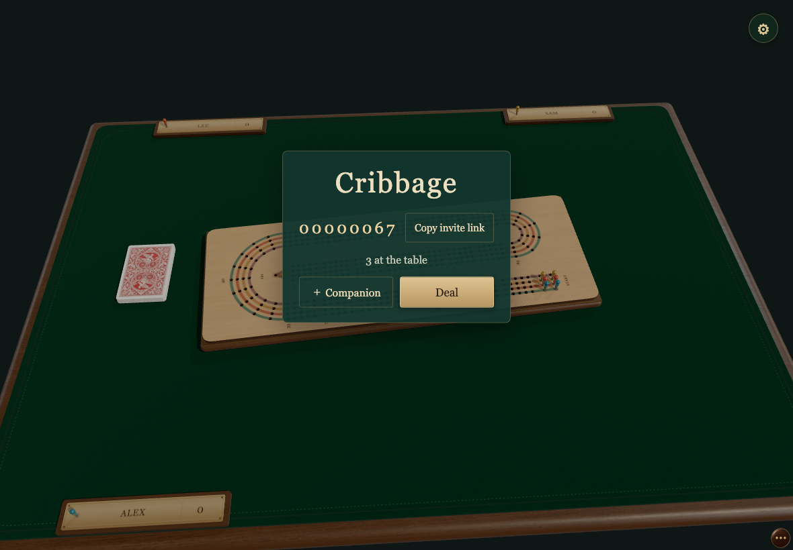
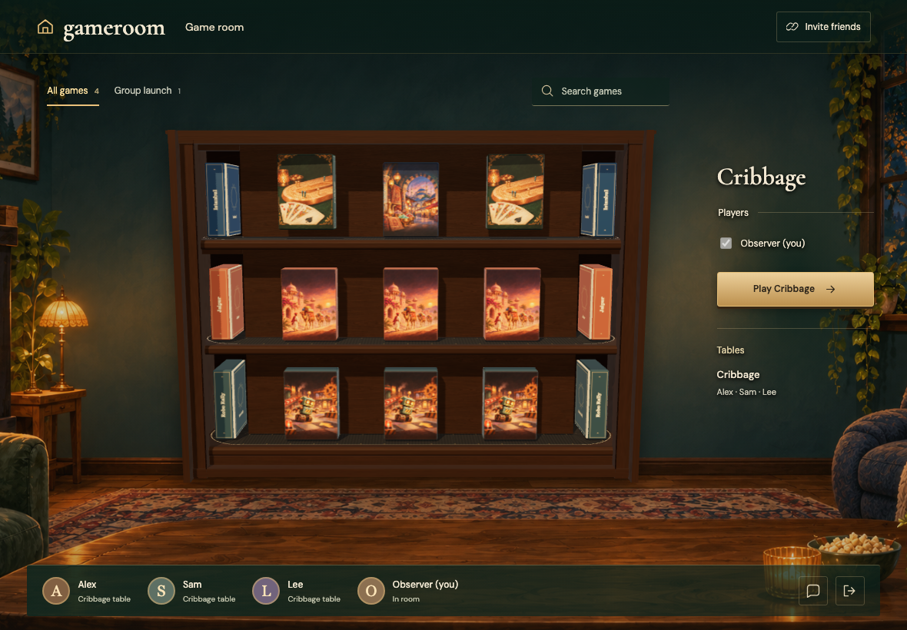
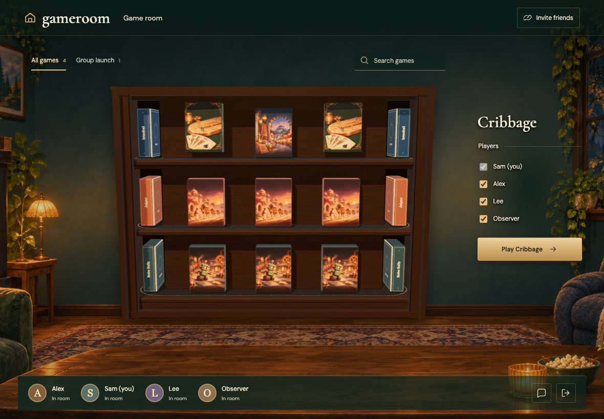

# CONCURRENT-ARRIVALS

Real Firestore and Auth emulators; independent browser identities. Desktop captures are 1180×820 at 1×; mobile captures are 390×844 with full-page capture. Every decoded RGBA byte must match. No masks, pixel tolerance, screenshot resizing or retries. Baselines are generated explicitly and verified in a separate run.

## The room includes friends and an explicitly excluded observer

Viewpoint: **Alex**

- [x] All four profiles share the gathering

## The room includes friends and an explicitly excluded observer

Viewpoint: **Sam**

- [x] All four profiles share the gathering

## The room includes friends and an explicitly excluded observer

Viewpoint: **Lee**

- [x] All four profiles share the gathering

## The room includes friends and an explicitly excluded observer

Viewpoint: **Observer**

- [x] All four profiles share the gathering

## One host click opens three overlays with distinct game seats

Viewpoint: **Alex**

- [x] Each selected profile shares the table without opening any tabs

## One host click opens three overlays with distinct game seats

Viewpoint: **Sam**

- [x] Each selected profile shares the table without opening any tabs

## One host click opens three overlays with distinct game seats

Viewpoint: **Lee**

- [x] Each selected profile shares the table without opening any tabs

## The excluded profile stays in the room

Viewpoint: **Observer**

- [x] Intended participation excludes the observer from game launch

## Closing the table clears every selected frame

Viewpoint: **Alex**

- [x] All four friends remain gathered with no game frames or extra tabs

## Closing the table clears every selected frame

Viewpoint: **Sam**

- [x] All four friends remain gathered with no game frames or extra tabs

## Closing the table clears every selected frame

Viewpoint: **Lee**

- [x] All four friends remain gathered with no game frames or extra tabs

## Closing the table clears every selected frame

Viewpoint: **Observer**

- [x] All four friends remain gathered with no game frames or extra tabs
