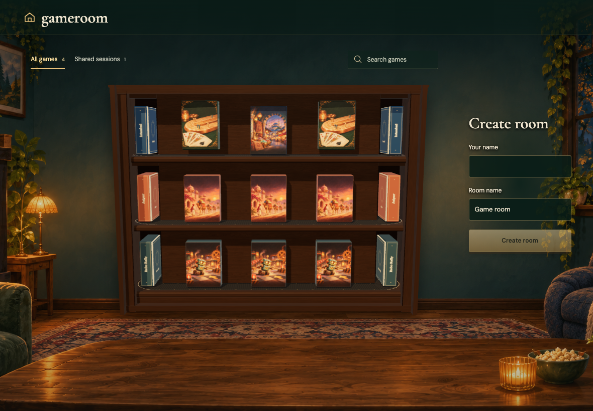
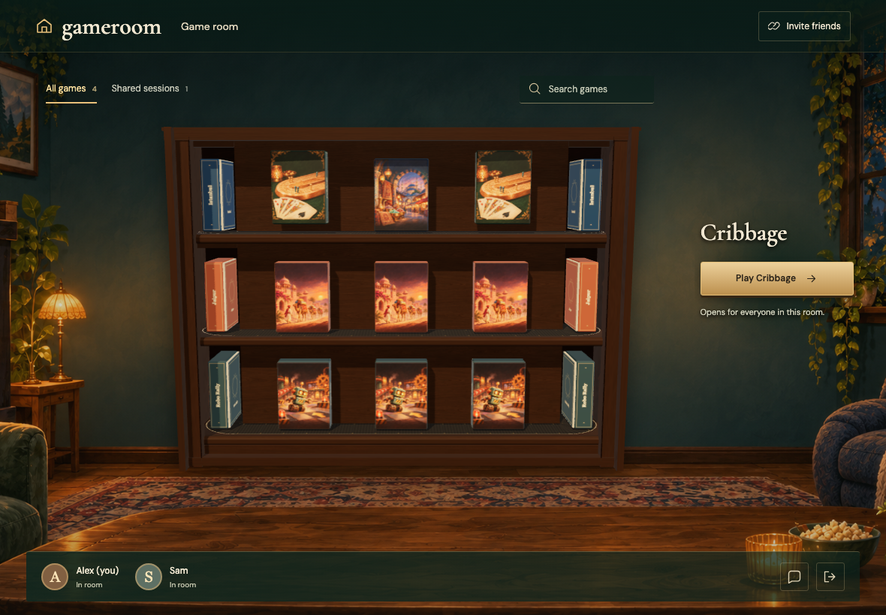
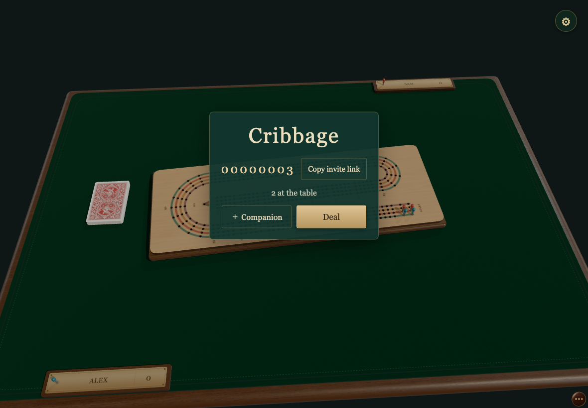
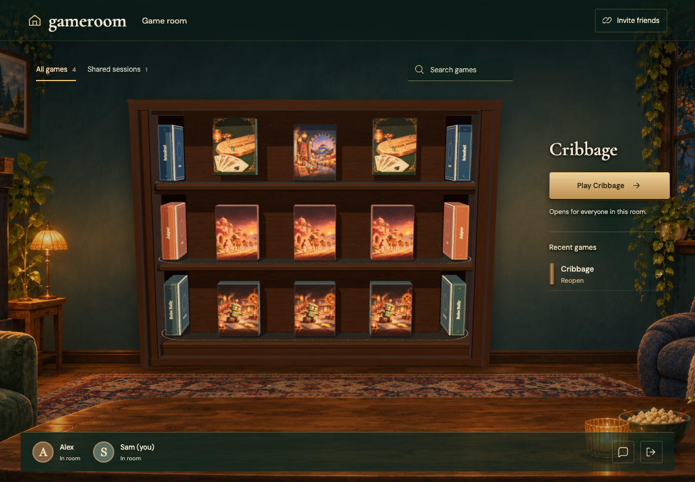
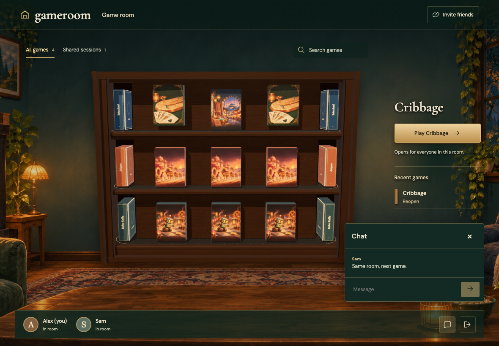
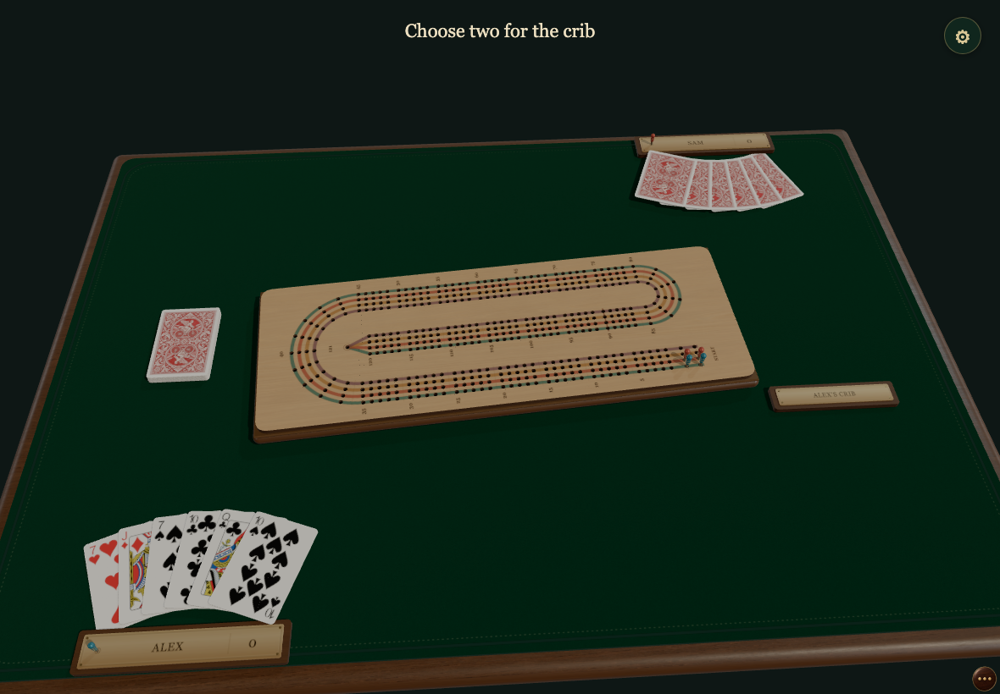
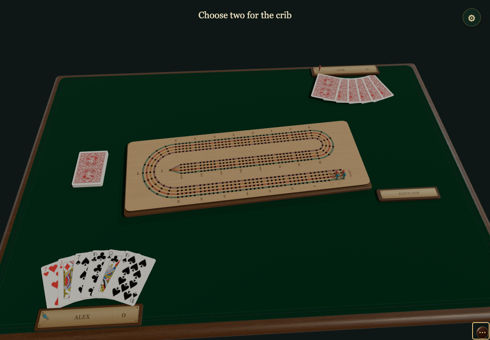
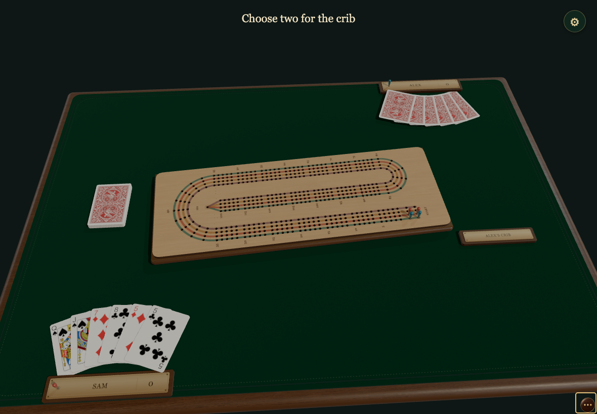
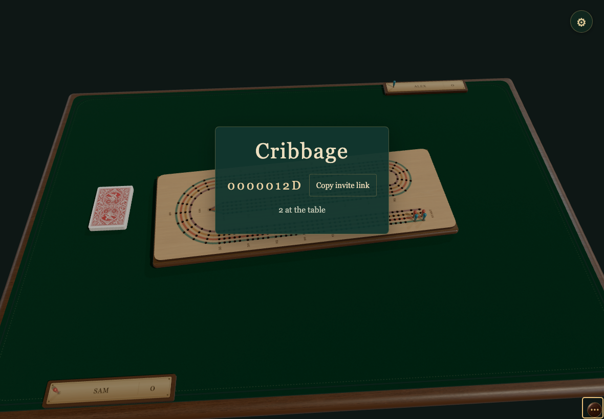

# GATHERING

Real Firestore and Auth emulators; independent browser identities. Desktop captures are 1180×820 at 1×; mobile captures are 390×844 with full-page capture. Every decoded RGBA byte must match. No masks, pixel tolerance, screenshot resizing or retries. Baselines are generated explicitly and verified in a separate run.

## The cozy den opens with a browsable collection

Viewpoint: **Alex**

- [x] The collection and room form are ready

## The whole room plays together

Viewpoint: **Alex**

- [x] Both members are present with no player-selection controls

## The whole room plays together

Viewpoint: **Sam**

- [x] Both members are present with no player-selection controls

## One Play action opens the same game for both members

Viewpoint: **Alex**

- [x] URL-named seats share one game and only its original creator can deal

## One Play action opens the same game for both members

Viewpoint: **Sam**

- [x] URL-named seats share one game and only its original creator can deal

## The guest closes the game for the entire room

Viewpoint: **Alex**

- [x] Both members return to one recent game link

## The guest closes the game for the entire room

Viewpoint: **Sam**

- [x] Both members return to one recent game link

## Chat belongs to the persistent room

Viewpoint: **Alex**

- [x] The message and recent game are shared without reopening a game

## Chat belongs to the persistent room

Viewpoint: **Sam**

- [x] The message and recent game are shared without reopening a game

## A recent game reopens its original URL for everyone

Viewpoint: **Alex**

- [x] The same two seats return to the same game code with no extra tabs

## A recent game reopens its original URL for everyone

Viewpoint: **Sam**

- [x] The same two seats return to the same game code with no extra tabs

## The reopened game can deal a real private hand

Viewpoint: **Alex**

- [x] The other hand has six face-down cards

## The reopened game can deal a real private hand

Viewpoint: **Sam**

- [x] The other hand has six face-down cards

## Reload follows the room’s current game

Viewpoint: **Alex**

- [x] The original URLs, seats and dealt hand survive

## Reload follows the room’s current game

Viewpoint: **Sam**

- [x] The original URLs, seats and dealt hand survive

## A shared close stays closed after reload

Viewpoint: **Alex**

- [x] The game remains a recent link without a finished-versus-resumable status

## A shared close stays closed after reload

Viewpoint: **Sam**

- [x] The game remains a recent link without a finished-versus-resumable status

## The bookshelf starts a new game for the same room

Viewpoint: **Alex**

- [x] A fresh game code opens for both profiles and the previous game stays in history

## The bookshelf starts a new game for the same room

Viewpoint: **Sam**

- [x] A fresh game code opens for both profiles and the previous game stays in history
