# GATHERING

Real Firestore and Auth emulators; independent browser identities. Desktop captures are 1180×820 at 1×; mobile captures are 390×844 with full-page capture. Every decoded RGBA byte must match. No masks, pixel tolerance, screenshot resizing or retries. Baselines are generated explicitly and verified in a separate run.

## The cozy den opens with a browsable collection

Viewpoint: **Alex**

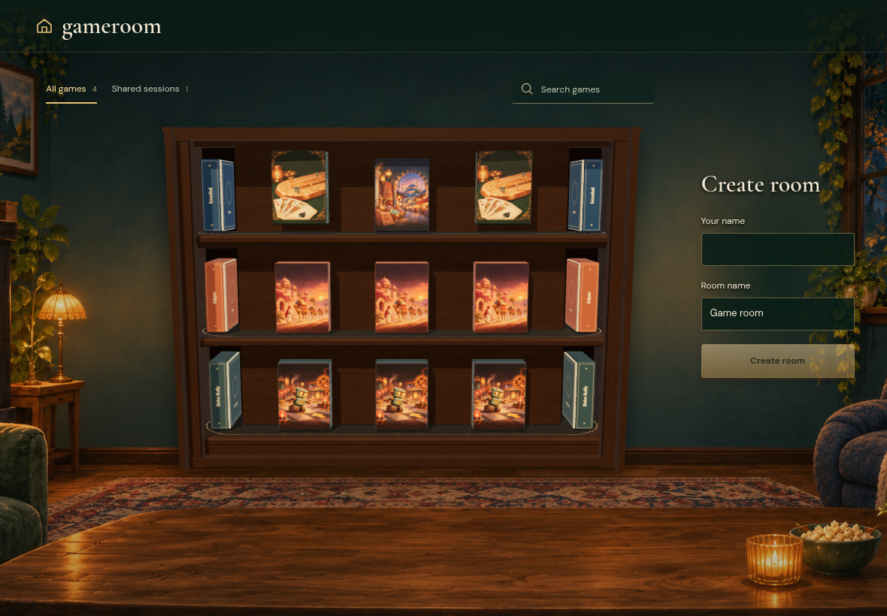

- [x] The collection and room form are ready

## Friends are included in the next game by default

Viewpoint: **Alex**

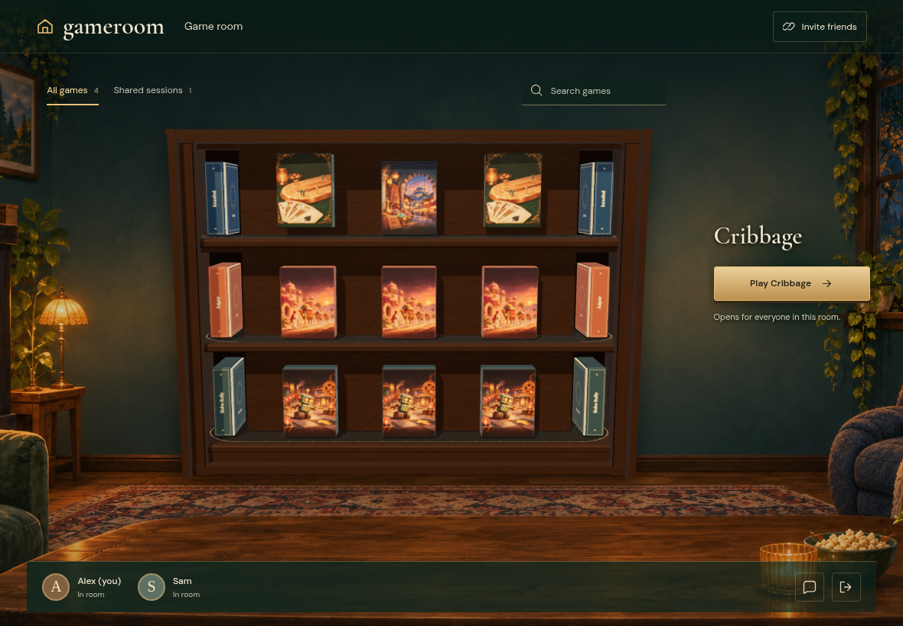

- [x] Both friends are present and selected

## Friends are included in the next game by default

Viewpoint: **Sam**

- [x] Both friends are present and selected

## One Play action opens both game overlays without popups

Viewpoint: **Alex**

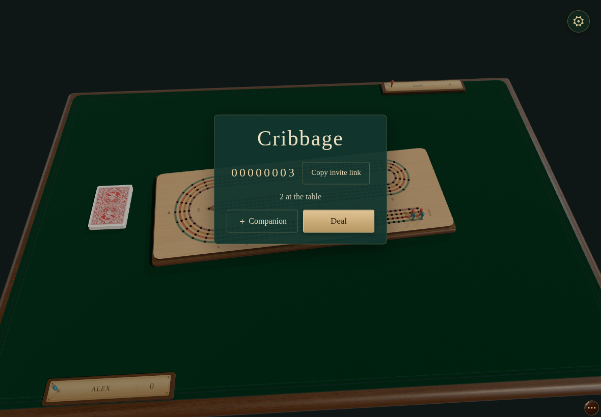

- [x] Both URL-named seats share one table and only the host can deal

## One Play action opens both game overlays without popups

Viewpoint: **Sam**

- [x] Both URL-named seats share one table and only the host can deal

## Room chat continues while the game is hidden

Viewpoint: **Alex**

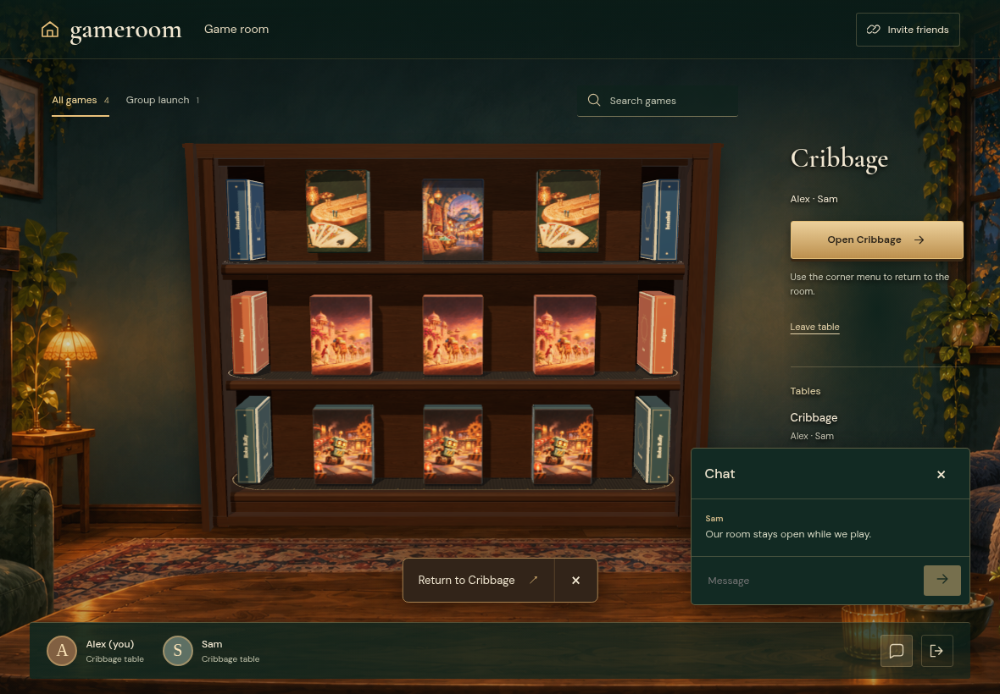

- [x] Messages arrive without reopening or unloading either frame

## Room chat continues while the game is hidden

Viewpoint: **Sam**

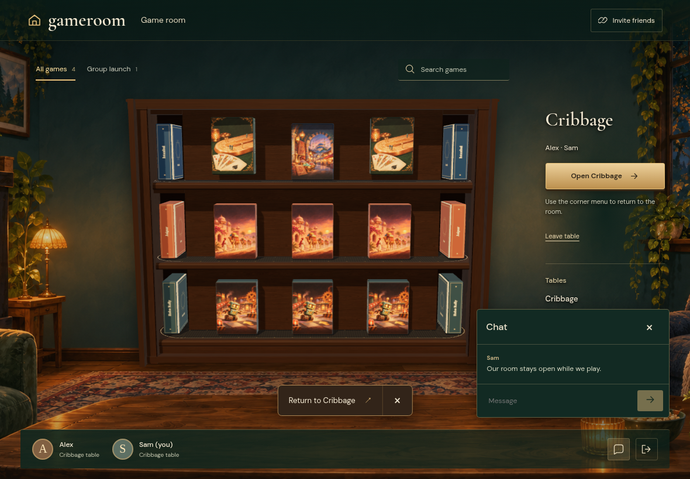

- [x] Messages arrive without reopening or unloading either frame

## The host deals a real private two-player hand

Viewpoint: **Alex**

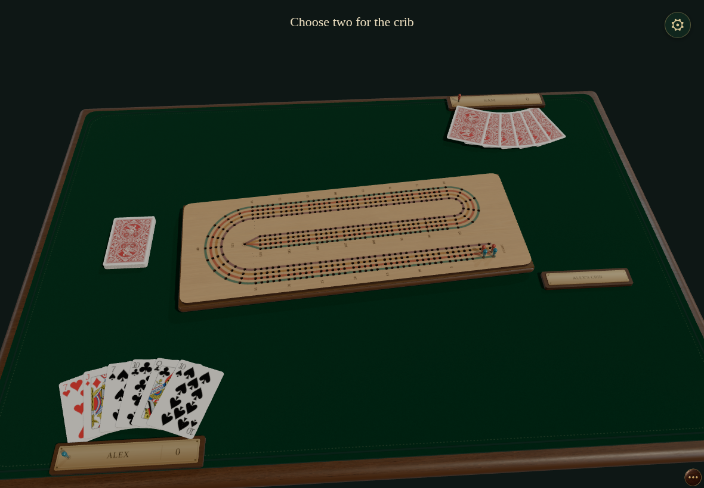

- [x] The other hand has six face-down cards

## The host deals a real private two-player hand

Viewpoint: **Sam**

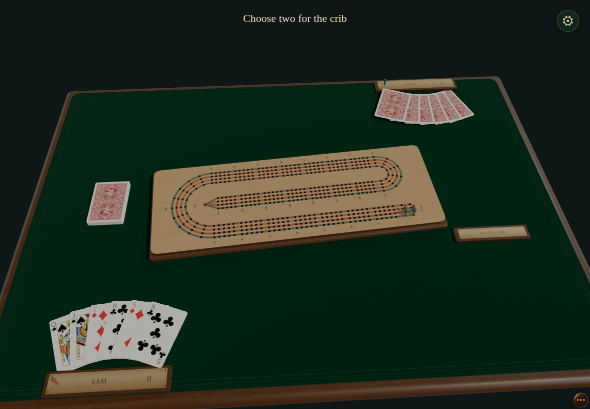

- [x] The other hand has six face-down cards

## Reload restores one overlay and the existing game

Viewpoint: **Alex**

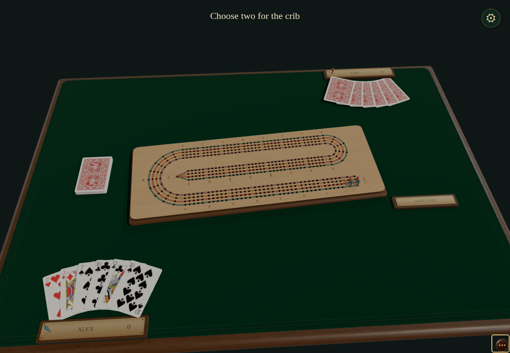

- [x] The same two seats and dealt hand survive without extra tabs

## Reload restores one overlay and the existing game

Viewpoint: **Sam**

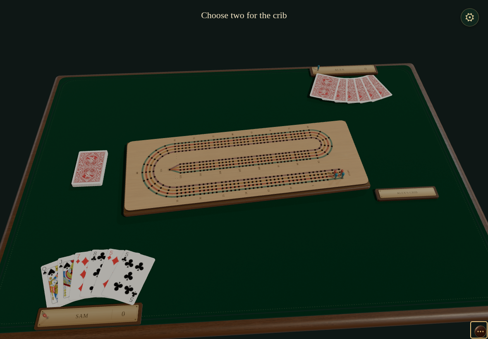

- [x] The same two seats and dealt hand survive without extra tabs

## Friends leave the table from the persistent room

Viewpoint: **Alex**

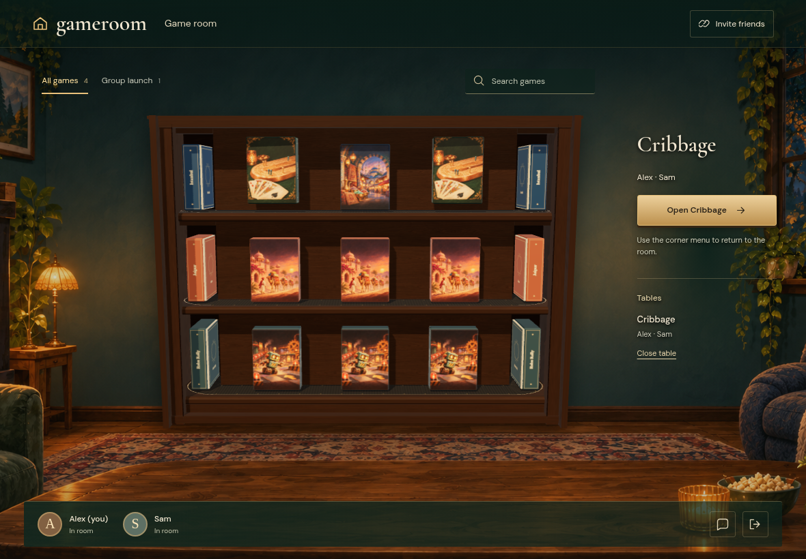

- [x] Both return to the shelves and their game frames are cleared

## Friends leave the table from the persistent room

Viewpoint: **Sam**

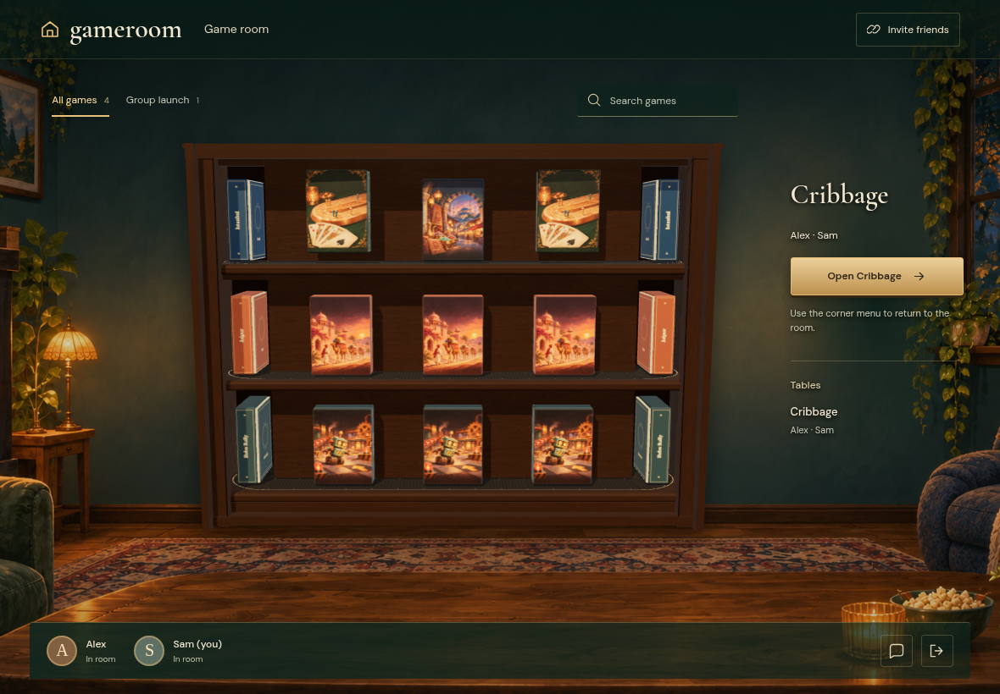

- [x] Both return to the shelves and their game frames are cleared

## A later launch opens a fresh shared game automatically

Viewpoint: **Alex**

- [x] Closed receipts from the previous table do not block the new table

## A later launch opens a fresh shared game automatically

Viewpoint: **Sam**

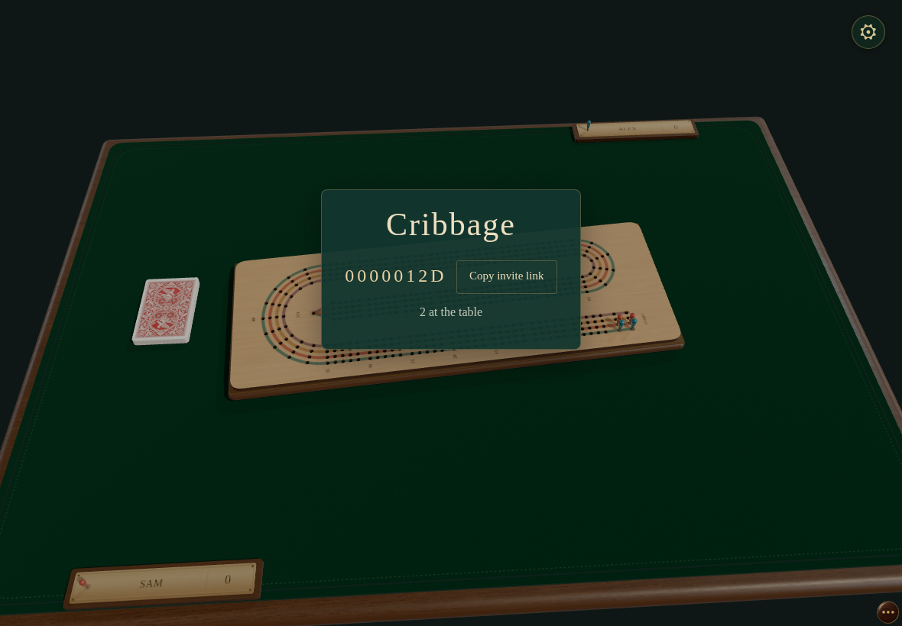

- [x] Closed receipts from the previous table do not block the new table
