# GATHERING

Real Firestore and Auth emulators; independent browser identities. Desktop captures are 1180×820 at 1×; mobile captures are 390×844 with full-page capture. Every decoded RGBA byte must match. No masks, pixel tolerance, screenshot resizing or retries. Baselines are generated explicitly and verified in a separate run.

## The cozy den opens with a browsable collection

Viewpoint: **Alex**

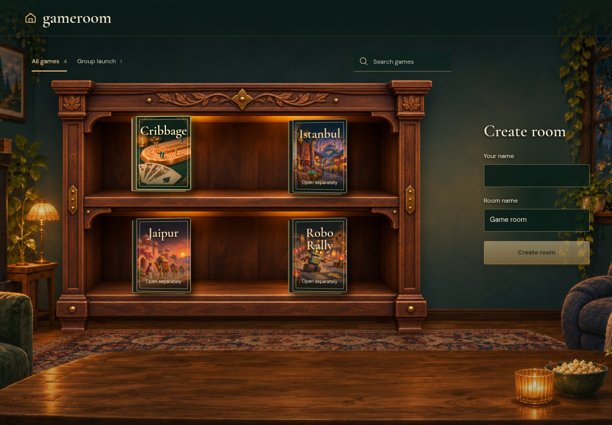

- [x] The collection and room form are ready

## Friends are included in the next game by default

Viewpoint: **Alex**

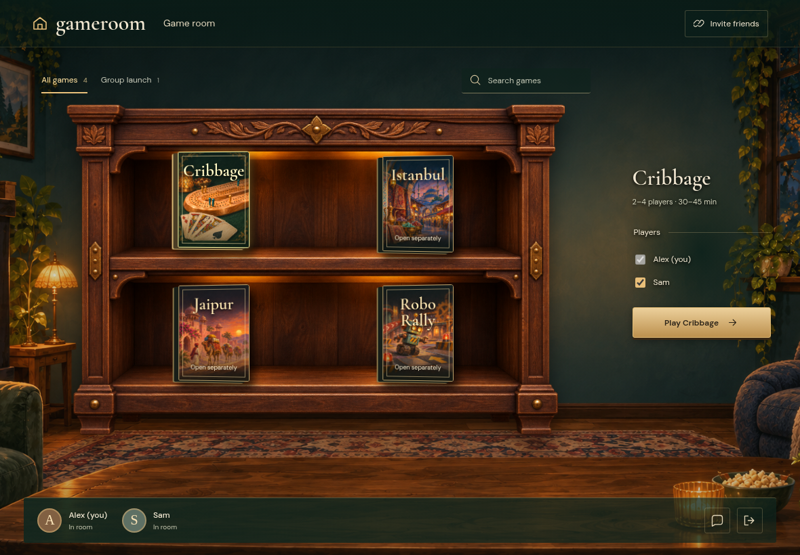

- [x] Both friends are present and selected

## Friends are included in the next game by default

Viewpoint: **Sam**

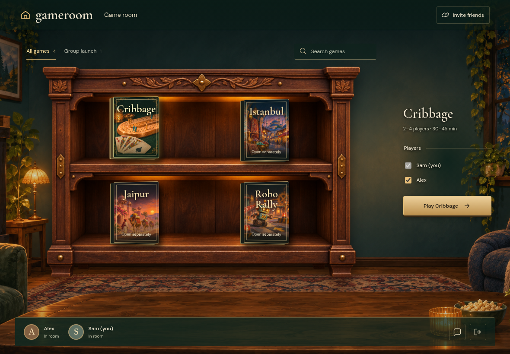

- [x] Both friends are present and selected

## Gameroom stays open while Cribbage uses another tab

Viewpoint: **Alex**

- [x] The room remains on its invitation URL and offers a game button

## Gameroom stays open while Cribbage uses another tab

Viewpoint: **Sam**

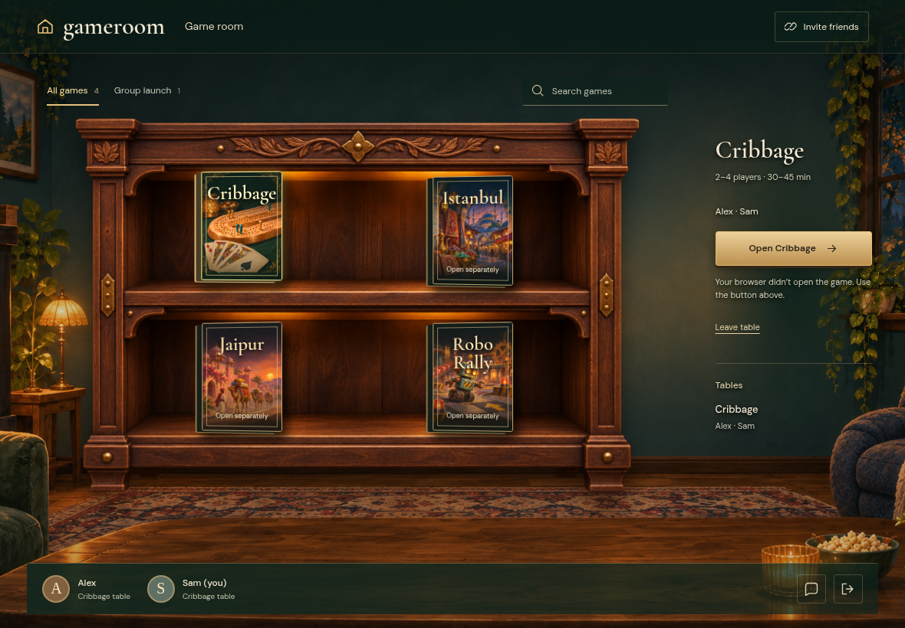

- [x] The room remains on its invitation URL and offers a game button

## The host table opens directly from the Play click

Viewpoint: **Alex**

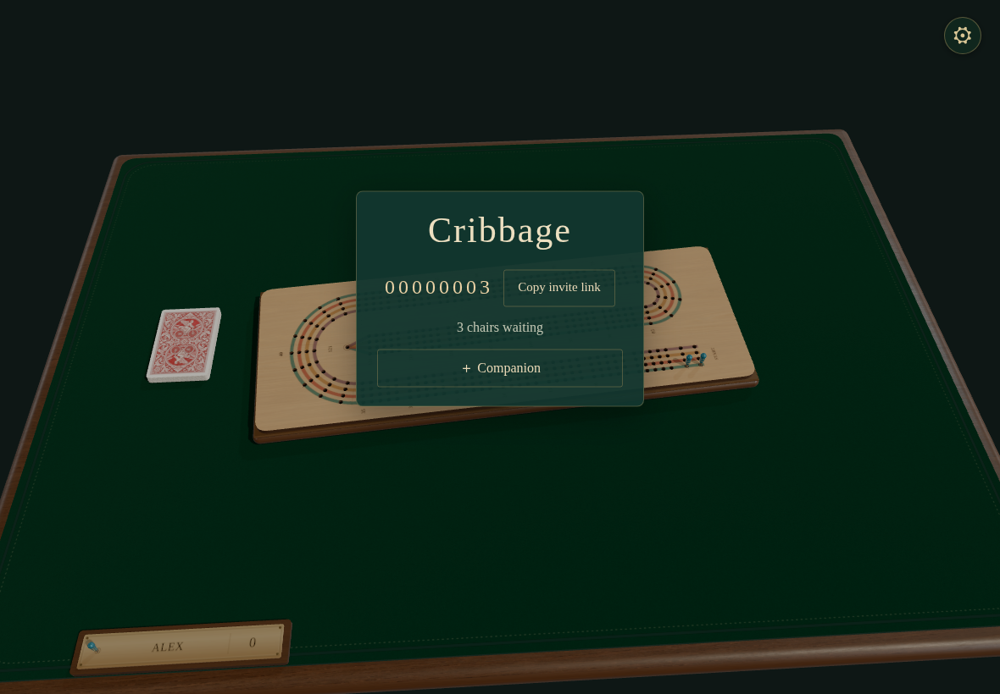

- [x] The host name is populated without a game-side Join click

## The fallback click joins the same table with the URL name

Viewpoint: **Alex**

- [x] Two players are seated with only Alex able to deal

## The fallback click joins the same table with the URL name

Viewpoint: **Sam**

- [x] Two players are seated with only Alex able to deal

## Room chat continues with both game tabs open

Viewpoint: **Alex**

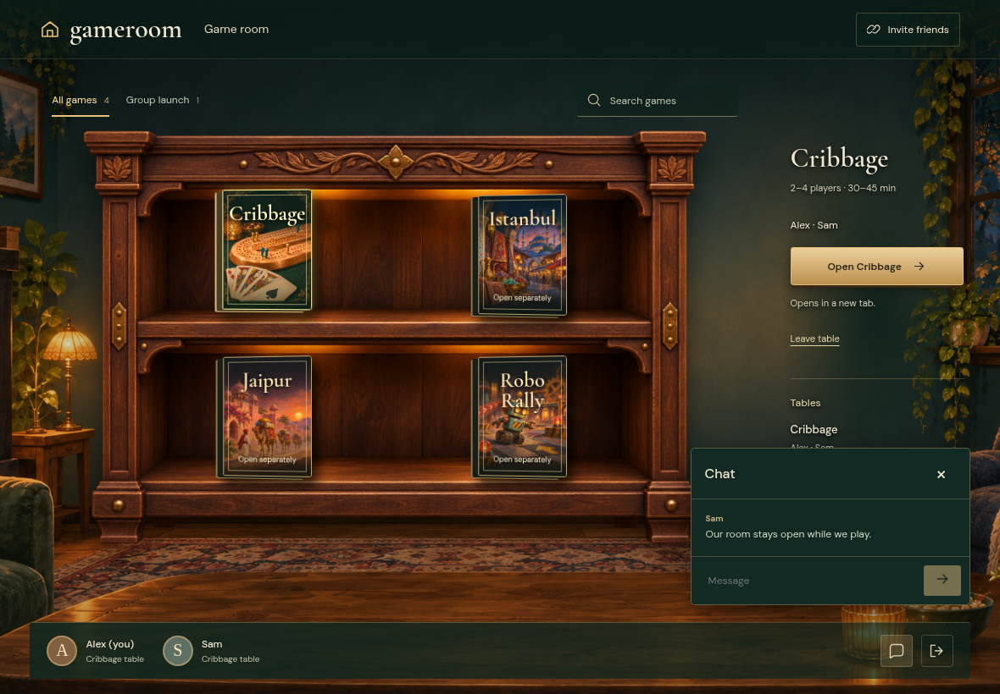

- [x] The shared message arrives in both room profiles

## Room chat continues with both game tabs open

Viewpoint: **Sam**

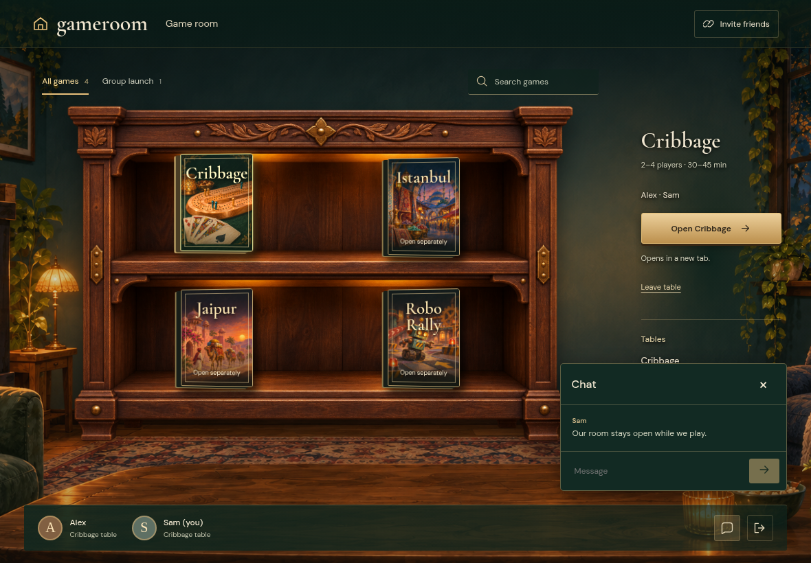

- [x] The shared message arrives in both room profiles

## The host deals a real two-player hand

Viewpoint: **Alex**

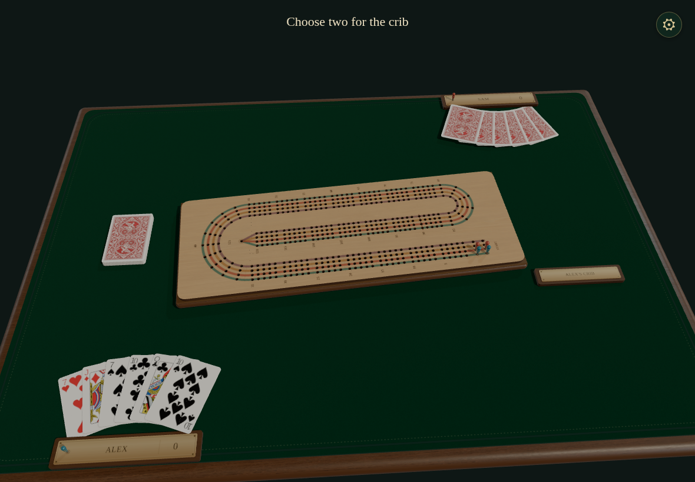

- [x] Both hands have six cards and the other hand remains private

## The host deals a real two-player hand

Viewpoint: **Sam**

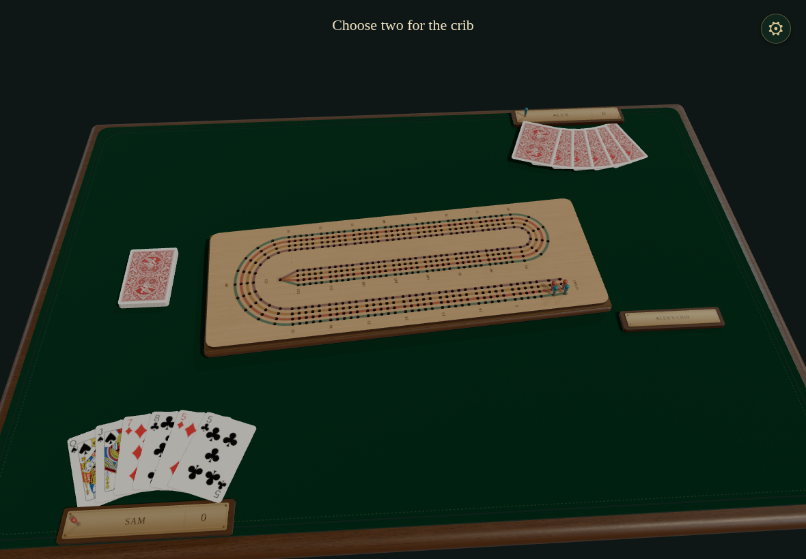

- [x] Both hands have six cards and the other hand remains private

## Reload does not open duplicate game tabs

Viewpoint: **Alex**

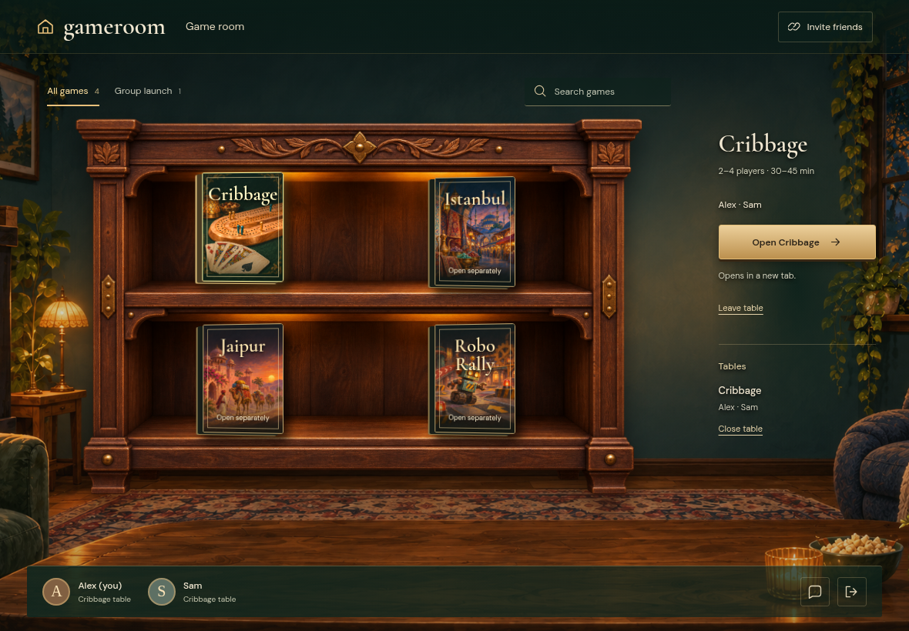

- [x] A manual reopen button remains available and no new tab was spawned

## Reload does not open duplicate game tabs

Viewpoint: **Sam**

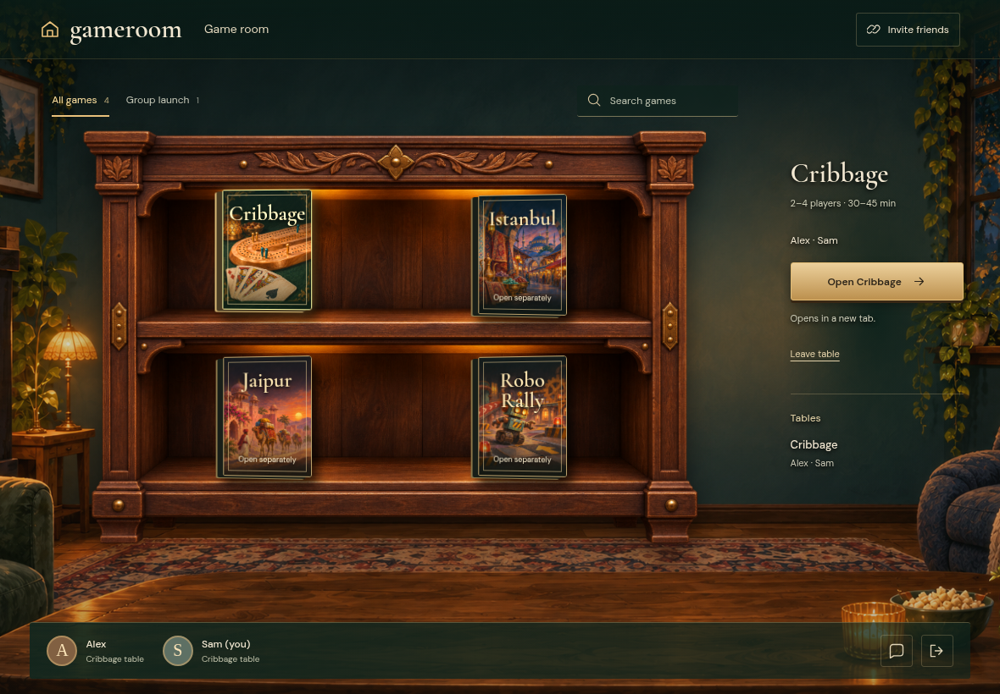

- [x] A manual reopen button remains available and no new tab was spawned

## Friends leave the table directly from the persistent room

Viewpoint: **Alex**

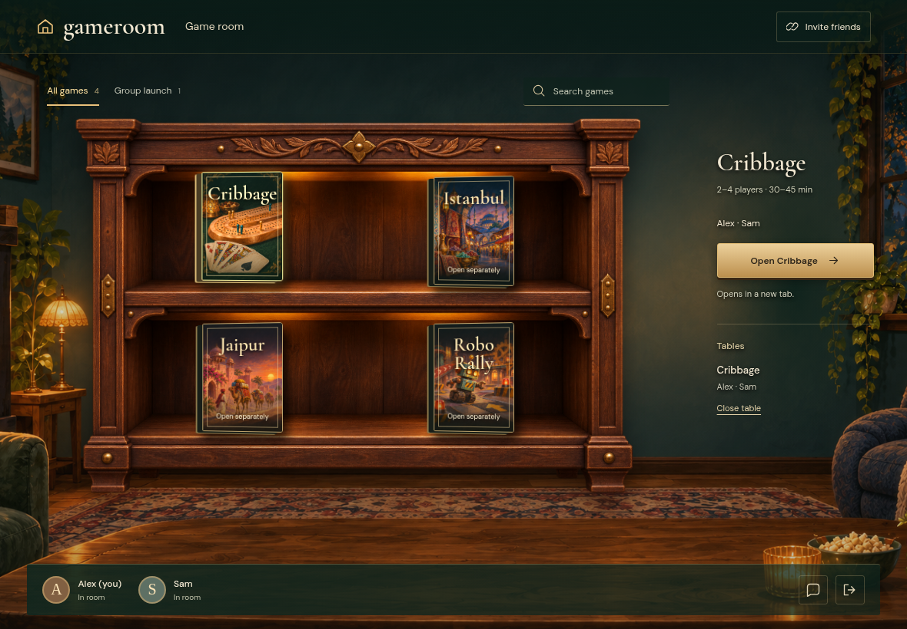

- [x] Both friends are by the shelves

## Friends leave the table directly from the persistent room

Viewpoint: **Sam**

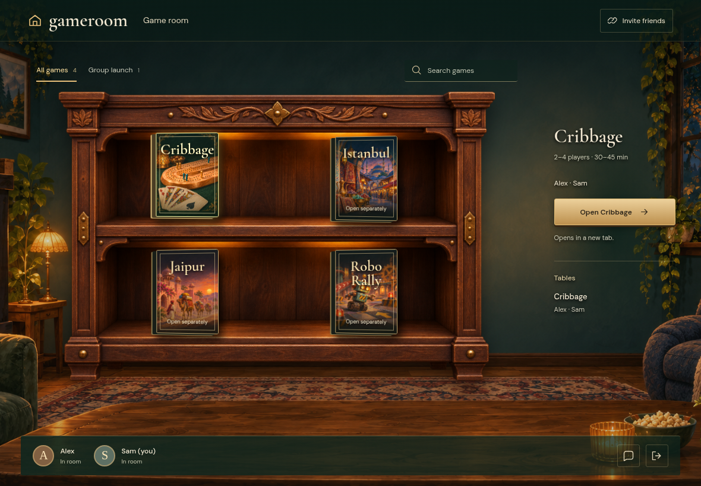

- [x] Both friends are by the shelves

## A later game opens a fresh shared table

Viewpoint: **Alex**

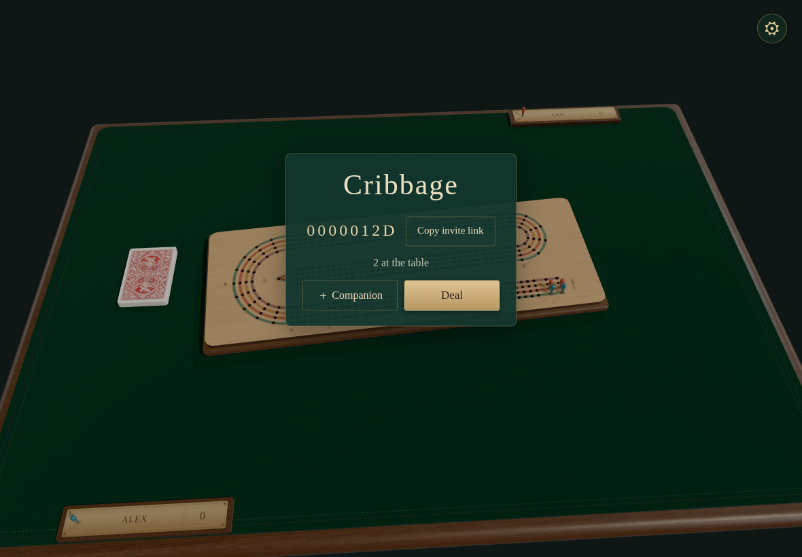

- [x] Both profiles reach the same new table while their rooms remain open

## A later game opens a fresh shared table

Viewpoint: **Sam**

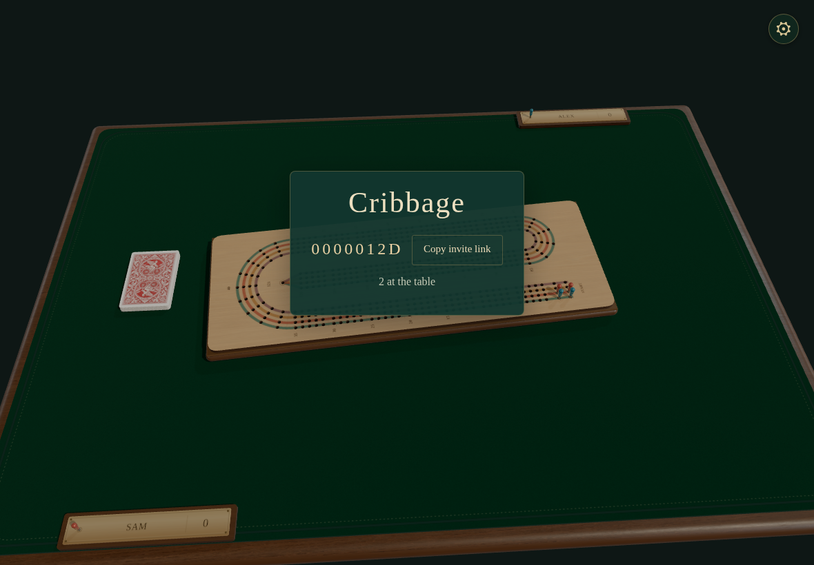

- [x] Both profiles reach the same new table while their rooms remain open
