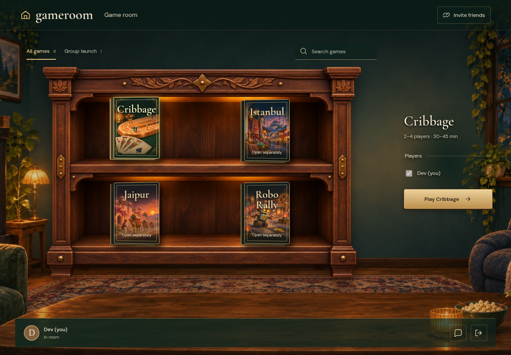
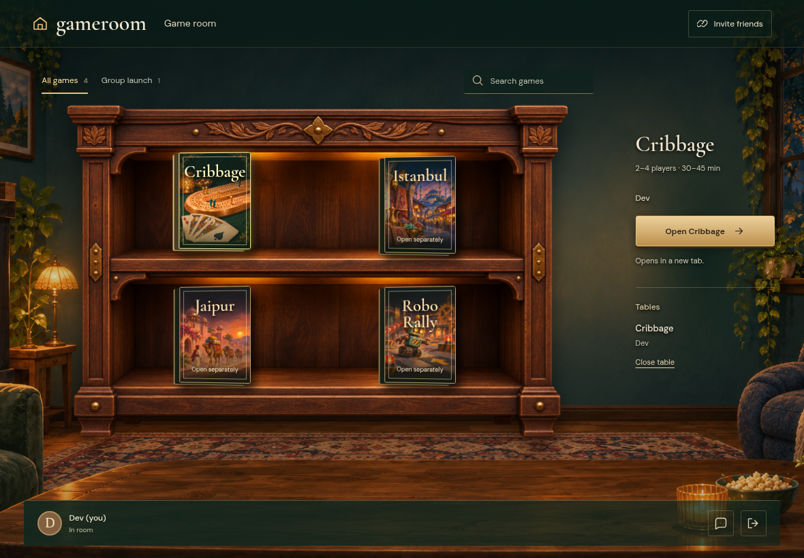

# HTTP-ORIGIN

Real Firestore and Auth emulators; independent browser identities. Desktop captures are 1180×820 at 1×; mobile captures are 390×844 with full-page capture. Every decoded RGBA byte must match. No masks, pixel tolerance, screenshot resizing or retries. Baselines are generated explicitly and verified in a separate run.

## A real HTTP origin opens a room without randomUUID

Viewpoint: **Dev**

- [x] The room has a valid code and its create command is committed to Firestore

## The game opens separately while the original HTTP room stays connected

Viewpoint: **Dev**

- [x] The native UUID API is still absent and the saved game remains resumable
