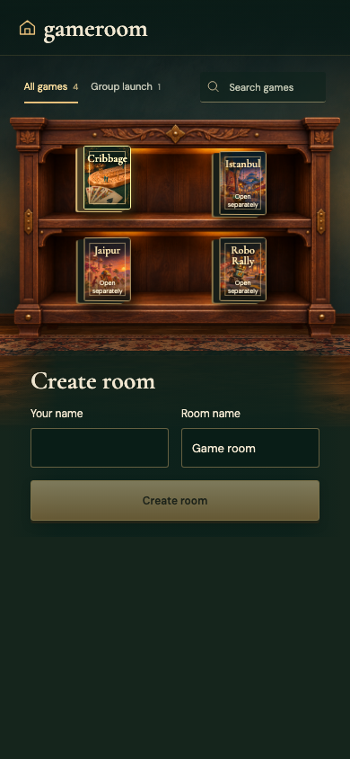
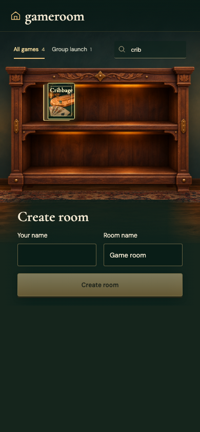
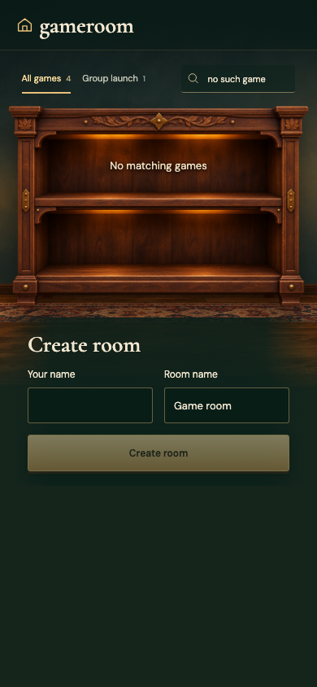
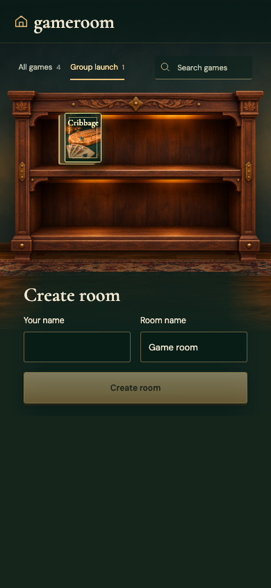

# MOBILE

Real Firestore and Auth emulators; independent browser identities. Desktop captures are 1180×820 at 1×; mobile captures are 390×844 with full-page capture. Every decoded RGBA byte must match. No masks, pixel tolerance, screenshot resizing or retries. Baselines are generated explicitly and verified in a separate run.

## The den adapts to a phone

Viewpoint: **Visitor**

- [x] The gathering form and four selectable game boxes fit without horizontal scrolling

## Search leaves one full-size game on the shelf

Viewpoint: **Visitor**

- [x] Cribbage remains selectable and other boxes are filtered out

## An empty search has a clear way back

Viewpoint: **Visitor**

- [x] The shelf explains that there are no matching games

## The playable filter shows only the integrated game

Viewpoint: **Visitor**

- [x] Cribbage is the one game ready to launch
