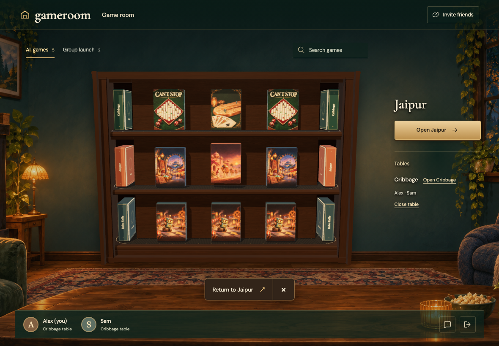
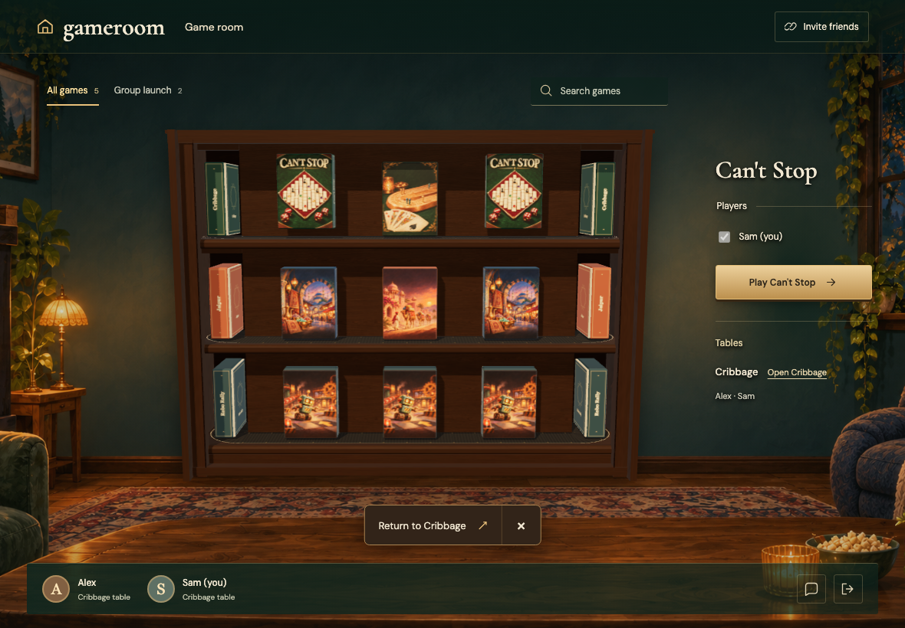
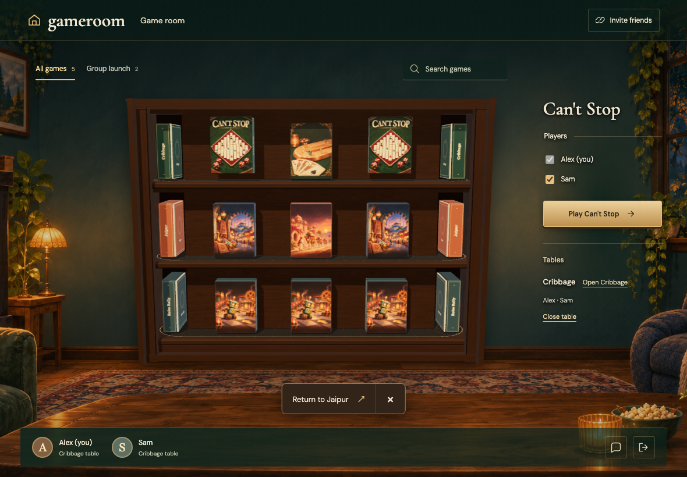
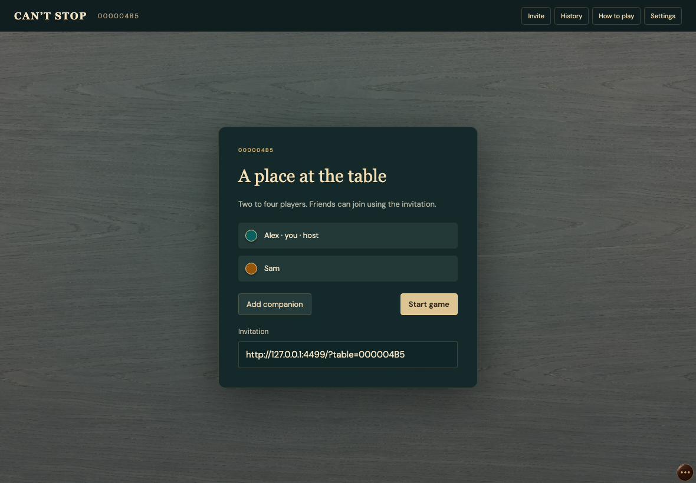
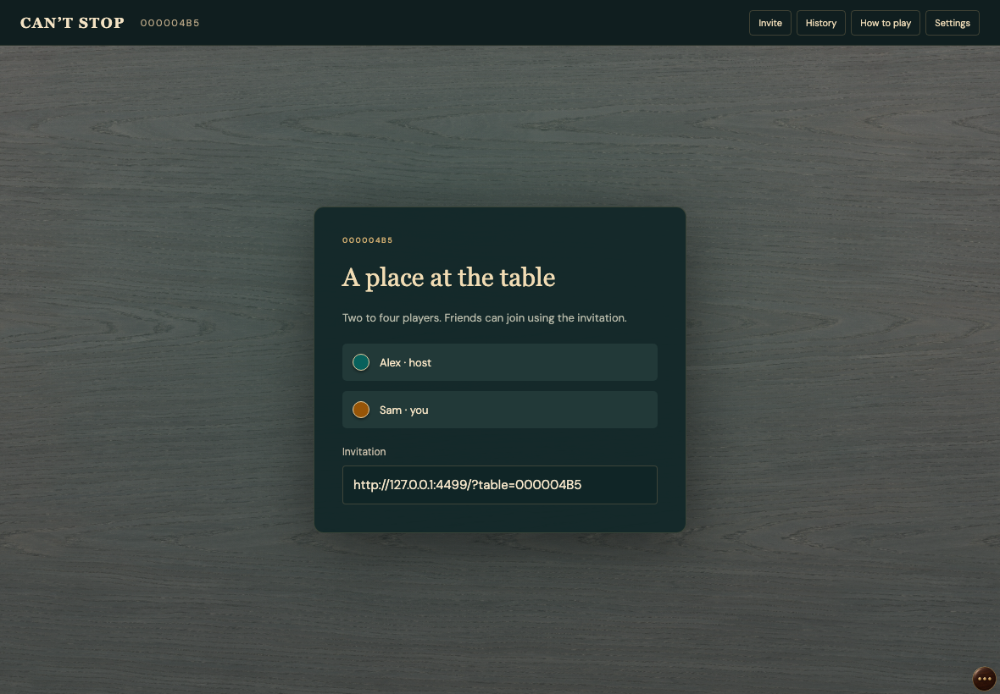

# NEXT-GAME

Real Firestore and Auth emulators; independent browser identities. Desktop captures are 1180×820 at 1×; mobile captures are 390×844 with full-page capture. Every decoded RGBA byte must match. No masks, pixel tolerance, screenshot resizing or retries. Baselines are generated explicitly and verified in a separate run.

## A URL-only selection opens without replacing the other player’s game

Viewpoint: **Alex**

- [x] The old table remains available and no new tab was created

## A URL-only selection opens without replacing the other player’s game

Viewpoint: **Sam**

- [x] The old table remains available and no new tab was created

## The next integrated game has its own Play action

Viewpoint: **Alex**

- [x] The host’s current friend is included by default

## One Play action moves both profiles into the next game

Viewpoint: **Alex**

- [x] Both profiles share a new Can’t Stop table and the old room table is closed

## One Play action moves both profiles into the next game

Viewpoint: **Sam**

- [x] Both profiles share a new Can’t Stop table and the old room table is closed
