# NEXT-GAME

Real Firestore and Auth emulators; independent browser identities. Desktop captures are 1180×820 at 1×; mobile captures are 390×844 with full-page capture. Every decoded RGBA byte must match. No masks, pixel tolerance, screenshot resizing or retries. Baselines are generated explicitly and verified in a separate run.

## The room keeps one recent link after a shared close

Viewpoint: **Alex**

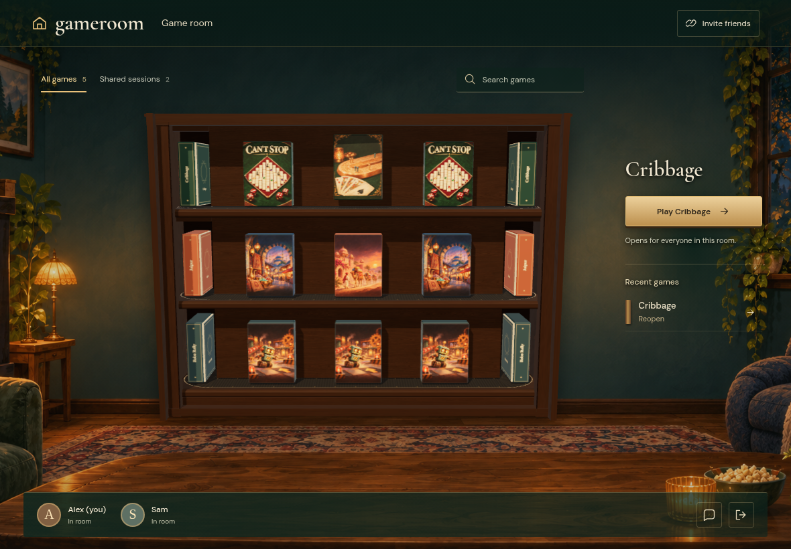

- [x] Both profiles are back in the same room with no game frame

## The room keeps one recent link after a shared close

Viewpoint: **Sam**

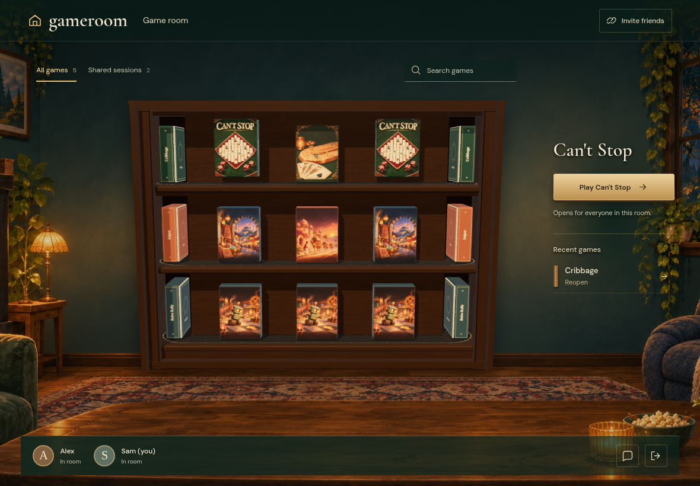

- [x] Both profiles are back in the same room with no game frame

## URL-only games open their exact address for everyone

Viewpoint: **Alex**

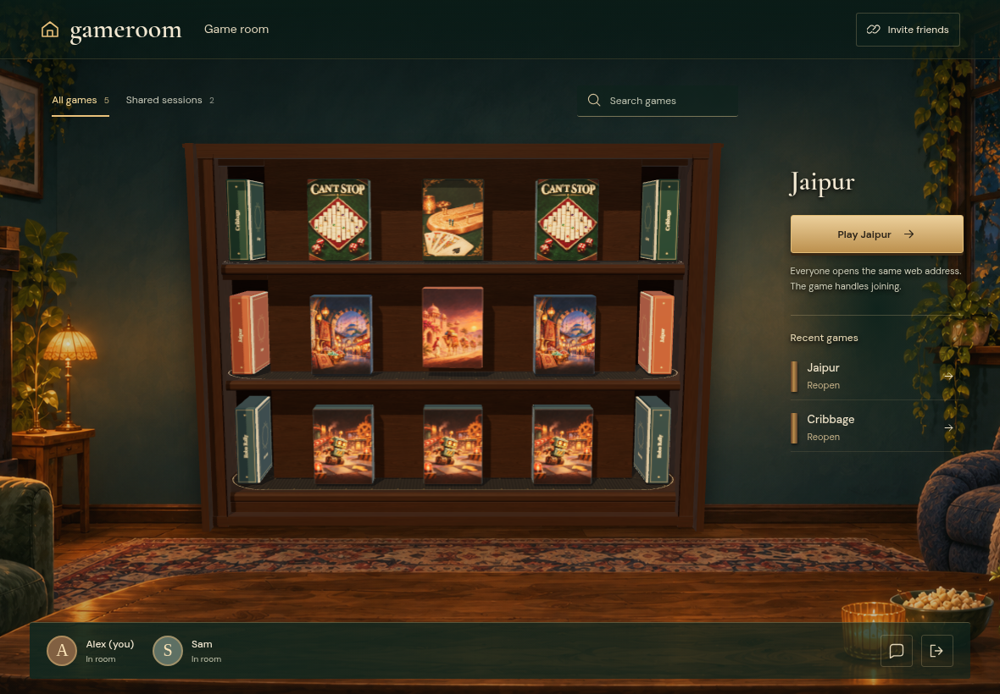

- [x] Both room members keep the same saved link without invented joining parameters

## URL-only games open their exact address for everyone

Viewpoint: **Sam**

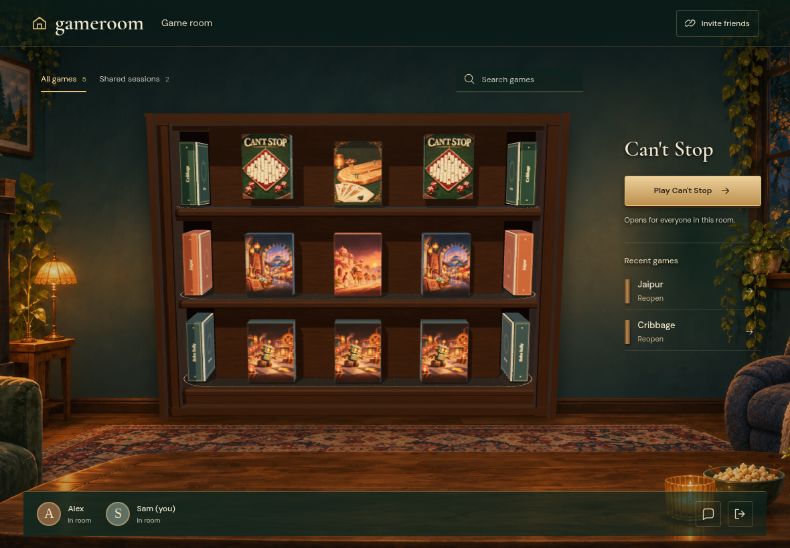

- [x] Both room members keep the same saved link without invented joining parameters

## The next game uses the whole room

Viewpoint: **Alex**

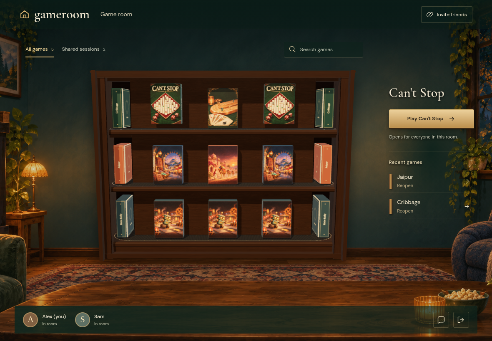

- [x] The game has its own Play action with no player selection or table controls

## One Play action opens the next game for both profiles

Viewpoint: **Alex**

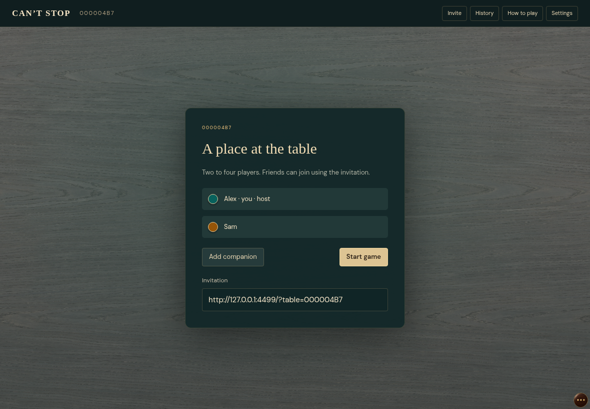

- [x] The guest reload restores the same two seats and a new game code

## One Play action opens the next game for both profiles

Viewpoint: **Sam**

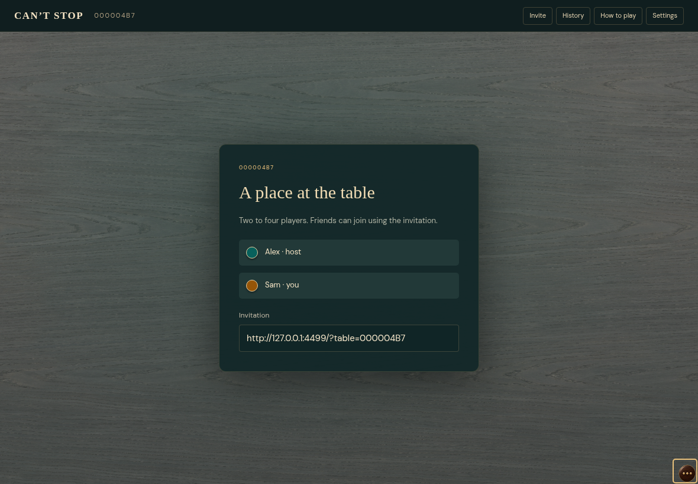

- [x] The guest reload restores the same two seats and a new game code

## A new room member joins the current game automatically

Viewpoint: **Alex**

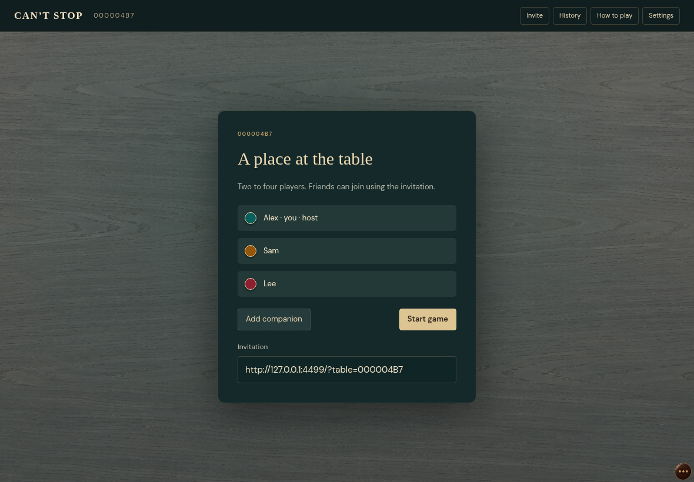

- [x] All three profiles share one game without restarting its existing windows

## A new room member joins the current game automatically

Viewpoint: **Sam**

- [x] All three profiles share one game without restarting its existing windows

## A new room member joins the current game automatically

Viewpoint: **Lee**

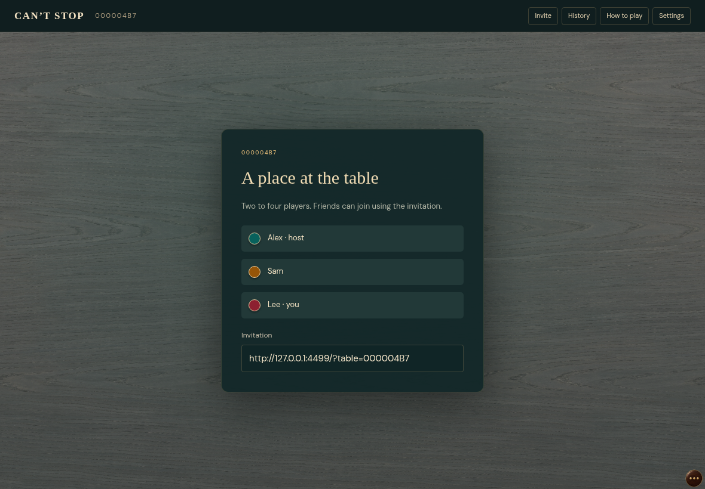

- [x] All three profiles share one game without restarting its existing windows

## A late arrival can close the game for the entire room

Viewpoint: **Alex**

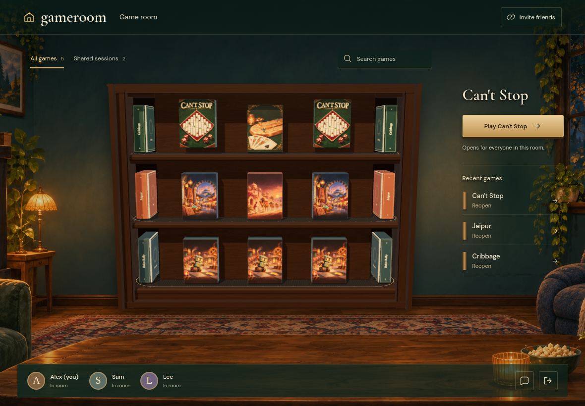

- [x] The three recent links remain available with no ended-versus-resumable classification

## A late arrival can close the game for the entire room

Viewpoint: **Sam**

- [x] The three recent links remain available with no ended-versus-resumable classification

## A late arrival can close the game for the entire room

Viewpoint: **Lee**

- [x] The three recent links remain available with no ended-versus-resumable classification

## Reopening a recent game restores its original URLs for everyone

Viewpoint: **Alex**

- [x] The original creator stays the creator and every member returns to their existing seat

## Reopening a recent game restores its original URLs for everyone

Viewpoint: **Sam**

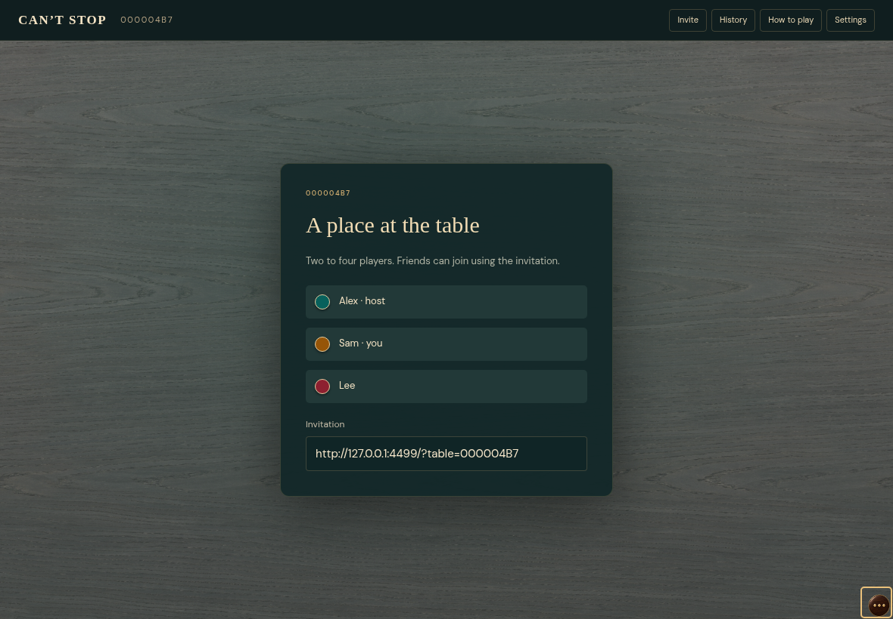

- [x] The original creator stays the creator and every member returns to their existing seat

## Reopening a recent game restores its original URLs for everyone

Viewpoint: **Lee**

- [x] The original creator stays the creator and every member returns to their existing seat
