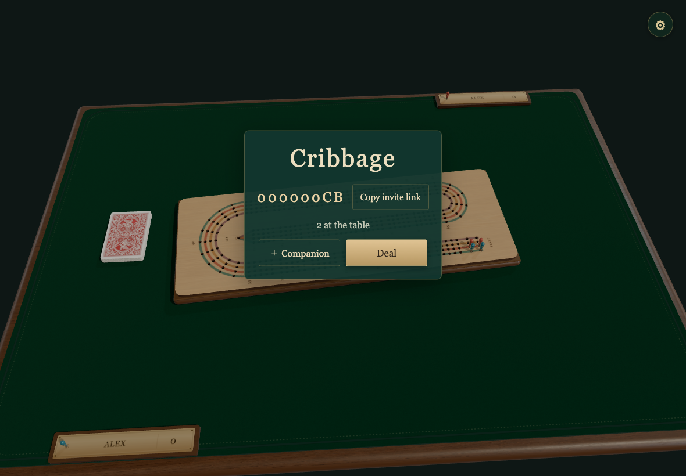
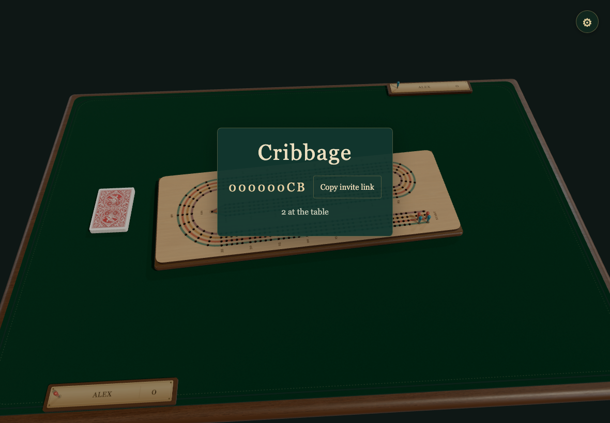
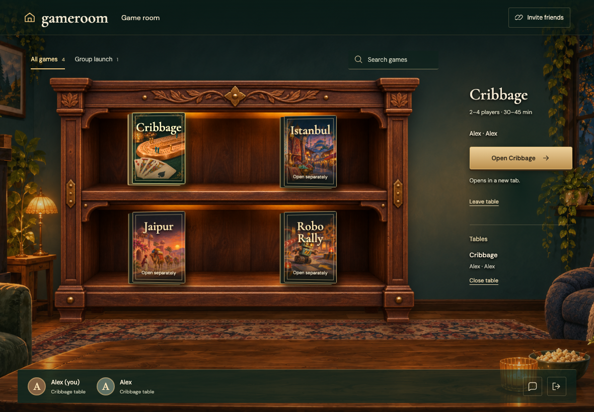
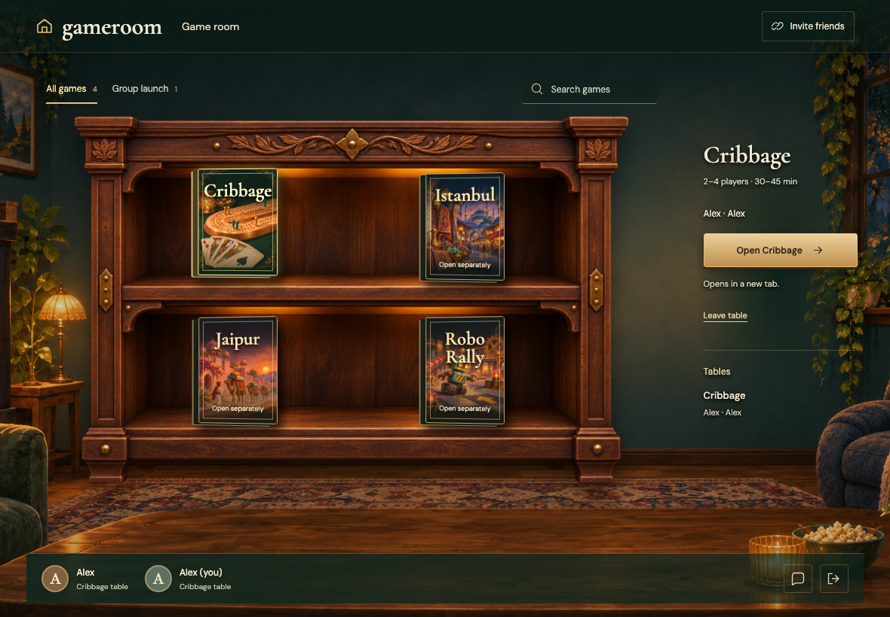

# SAME-NAME-PROFILES

Real Firestore and Auth emulators; independent browser identities. Desktop captures are 1180×820 at 1×; mobile captures are 390×844 with full-page capture. Every decoded RGBA byte must match. No masks, pixel tolerance, screenshot resizing or retries. Baselines are generated explicitly and verified in a separate run.

## Both Alex profiles have distinct seats in the same game

Viewpoint: **Host**

- [x] Two Alex seats exist and only the initiating profile can deal

## Both Alex profiles have distinct seats in the same game

Viewpoint: **Guest**

- [x] Two Alex seats exist and only the initiating profile can deal

## Both original gathering tabs stay open

Viewpoint: **Host**

- [x] Two identities remain in the original room with one shared table

## Both original gathering tabs stay open

Viewpoint: **Guest**

- [x] Two identities remain in the original room with one shared table
